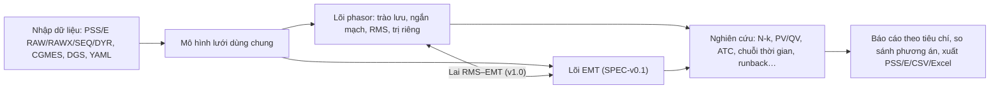

# Đặc tả mở rộng VnEMT — Phân tích, quy hoạch và vận hành lưới điện truyền tải

Tài liệu này mở rộng [SPEC-v0.1](SPEC-v0.1.md) (mô phỏng quá độ điện từ cho HVDC) thành một nền tảng phân tích hệ thống điện đầy đủ hơn, gồm ba nhóm tính năng:

| Mã nhóm | Nhóm tính năng | Mục |
| --- | --- | --- |
| G | Mô phỏng và phân tích hệ thống điện phổ biến trên thế giới (miền phasor: trào lưu, ngắn mạch, ổn định, sự cố N-k…) | [3](#3-nhóm-g--các-phân-tích-hệ-thống-điện-phổ-biến) |
| P | Tính toán quy hoạch, vận hành và nghiên cứu lưới điện truyền tải | [4](#4-nhóm-p--quy-hoạch-vận-hành-và-nghiên-cứu-lưới-truyền-tải) |
| R | Nghiên cứu runback / run-up (điều khiển công suất khẩn cấp HVDC) theo cả chiều thuận và chiều ngược | [5](#5-nhóm-r--nghiên-cứu-runback--run-up-hvdc) |

> **"Run back / Forward Study"** (đã xác nhận với đơn vị sử dụng ngày 29/10/2026): nghiên cứu điều khiển công suất khẩn cấp của liên kết HVDC — **runback** (giảm nhanh công suất truyền về mức đặt trước) và **run-up** (tăng nhanh công suất), xét cho cả chiều truyền thuận (forward) và chiều ngược (reverse).

Các nhóm G, P, R **không thuộc** phạm vi phát hành v0.1 của lõi EMT; chúng được lên lộ trình từ v0.4 (mục 8). Tài liệu này dùng để thiết kế kiến trúc từ đầu sao cho lõi EMT và phần phân tích miền phasor dùng chung một mô hình dữ liệu lưới.

---

## 1. Tham chiếu phần mềm phân tích lưới trên thế giới

| Phần mềm | Nhà phát triển | Chức năng tiêu biểu | VnEMT tham khảo |
| --- | --- | --- | --- |
| PSS/E | Siemens | Trào lưu (Newton, Gauss-Seidel), sự cố N-1/N-2/N-1-1 song song, PV/QV, LODF/PTDF, chuyển tải giới hạn (FCITC), OPF, ổn định động, ngắn mạch theo ANSI/IEC, sóng hài, GIC, trào lưu chuỗi thời gian, kiểm tra tiêu chí lưới tự động, Python API; công cụ chuyển dữ liệu sang PSCAD và co-simulation với PSCAD | Bộ chức năng chuẩn cho quy hoạch truyền tải; định dạng RAW/RAWX/SEQ/DYR |
| PowerFactory | DIgSILENT | Trào lưu, ngắn mạch, RMS, EMT, sóng hài, độ tin cậy, bảo vệ, phân tích chuỗi thời gian (quasi-dynamic) trong một mô hình | Một mô hình dữ liệu cho cả phasor và EMT |
| PSS/E + PSCAD | Siemens, MHI | Chuyển mô hình PSS/E sang PSCAD, co-simulation RMS–EMT | Lai RMS–EMT (mục 6) |
| pandapower | Fraunhofer IEE / Đại học Kassel, mã nguồn mở (BSD) | Trào lưu, ngắn mạch theo IEC 60909, ước lượng trạng thái, tối ưu, dùng Python | Có thể tái sử dụng hoặc dùng làm chuẩn so sánh |
| MATPOWER | Mã nguồn mở (BSD) | Trào lưu, OPF; bộ lưới thử chuẩn IEEE | Chuẩn so sánh trào lưu, OPF |
| PowSyBl | LF Energy, mã nguồn mở (MPL-2.0) | Nhập/xuất PSS/E RAW/RAWX, CGMES, phân tích sự cố, an ninh | Tham khảo bộ đọc định dạng |

Ghi chú: danh mục chức năng PSS/E lấy theo tài liệu giới thiệu của Siemens ([PSS/E brochure](https://assets.new.siemens.com/siemens/assets/api/uuid:3a9c726f-79aa-4a69-9f63-1daffbed5725/si-gsw-psse-simulation-and-modelling-for-tranmission-grid-planne.pdf)); điều khoản giấy phép của các thư viện mã nguồn mở phải kiểm tra lại trước khi tích hợp.

---

## 2. Kiến trúc mở rộng

### 2.1 Nguyên tắc

1. **Một mô hình dữ liệu lưới** (`vnemt.model`): nút, nhánh, MBA, máy phát, tải, thiết bị bù, HVDC LCC/VSC, cấu hình trạm (bus-branch và node-breaker). Mọi phân tích phasor và lõi EMT đều đọc từ đây.
2. **Hai lõi giải**: lõi EMT (SPEC-v0.1) và lõi phasor `vnemt.grid` (trào lưu, ngắn mạch, RMS, trị riêng).
3. **Nghiên cứu (study) là đối tượng có cấu hình**: loại nghiên cứu, kịch bản, tiêu chí, kết quả, báo cáo — chạy lại được, so sánh được giữa các phương án quy hoạch.



### 2.2 Cấu trúc mã bổ sung

```text
src/vnemt/
├── model/        # mô hình dữ liệu lưới chung, node-breaker ↔ bus-branch
├── grid/         # lõi phasor
│   ├── powerflow/      # NR, FDLF, DC, AC/DC
│   ├── shortcircuit/   # IEC 60909, sự cố không đối xứng
│   ├── dynamics/       # RMS: máy phát, kích từ, điều tốc, HVDC RMS, IBR
│   ├── smallsignal/    # tuyến tính hóa, trị riêng
│   ├── sensitivity/    # PTDF, LODF, OTDF
│   └── opf/
├── studies/      # contingency, pv_qv, transfer, timeseries, reliability, runback, planning
└── io/psse/      # raw, rawx, seq, dyr, sub/mon/con, out, psspy bridge
```

---

## 3. Nhóm G — Các phân tích hệ thống điện phổ biến

| Mã | Chức năng | Mô tả | Tiêu chí chấp nhận |
| --- | --- | --- | --- |
| G-01 | Trào lưu công suất AC | Newton–Raphson đầy đủ, tách nhanh (FDLF), Gauss-Seidel dự phòng; điều khiển nấc MBA, MBA dịch pha, tụ/kháng đóng cắt, SVC/STATCOM theo điện áp; giới hạn Q máy phát; điều khiển trao đổi khu vực | Lưới IEEE 14/39/118 nút: sai lệch điện áp < 1e-4 pu, góc < 0,01° so với MATPOWER |
| G-02 | Trào lưu DC (tuyến tính) | Cho phân tích nhanh, độ nhạy | |
| G-03 | Trào lưu AC/DC | HVDC LCC (Ud, Id, α, γ, nấc MBA, Q tiêu thụ) và VSC (P, Q, Udc, giới hạn PQ), lưới DC nhiều trạm | Khớp điểm làm việc EMT xác lập của cùng hệ (sai lệch P < 0,5 %) |
| G-04 | Ngắn mạch | Theo IEC 60909 (Ik″, ip, Ib, Ik, hệ số c); sự cố một pha, hai pha, hai pha chạm đất, ba pha; nhiều sự cố đồng thời; đóng góp dòng từ nguồn nghịch lưu (IBR) theo cách tiếp cận của IEC 60909 bản hiện hành | So sánh với ví dụ tính tay và pandapower |
| G-05 | Phân tích sự cố N-k | N-1, N-2, N-1-1; sự cố theo cấu hình trạm (máy cắt kẹt, sự cố thanh cái); chạy song song; lọc sự cố nghiêm trọng | 1000 sự cố trên lưới 2000 nút trong thời gian mục tiêu (đo ở mốc) |
| G-06 | Ổn định điện áp tĩnh | Đường cong PV, QV; điểm sụp đổ; sự cố giới hạn | |
| G-07 | Ổn định quá độ (RMS) | Máy phát (cổ điển, GENROU, GENSAL), kích từ IEEE 421.5, điều tốc, PSS; tải động; HVDC RMS (LCC, VSC); nguồn nghịch lưu chung (mô hình WECC/IEC 61400-27 dạng chung); sự kiện, sự cố, cắt máy cắt | Lưới IEEE 9/39 nút: góc rotor khớp phần mềm tham chiếu |
| G-08 | Ổn định tín hiệu nhỏ | Tuyến tính hóa quanh điểm làm việc, trị riêng, hệ số cản, hệ số tham gia, mode shape | |
| G-09 | Ổn định tần số | Đáp ứng tần số sau mất nguồn lớn, RoCoF, tần số đáy, đóng góp của HVDC (điều khiển tần số, quán tính ảo) | |
| G-10 | Phân tích độ nhạy | PTDF, LODF, OTDF, độ nhạy điện áp theo Q | |
| G-11 | Tối ưu trào lưu (OPF) | Cực tiểu chi phí, tổn thất; ràng buộc an ninh N-1 (SCOPF phòng ngừa) | v0.7 |
| G-12 | Sóng hài và quét tần số | Quét tổng trở theo tần số, cộng hưởng; THD so với giới hạn IEC/IEEE (dùng chung SPEC-v0.1 F5-06, F5-07) | |
| G-13 | Lưới tương đương | Thevenin, Ward, REI; dùng làm biên cho mô phỏng EMT chi tiết | Ngắn mạch tại biên khớp lưới đầy đủ |
| G-14 | Tính thông số đường dây | R, X, B thứ tự thuận/không từ hình học cột, dây dẫn, dây chống sét | So với bảng tính tay |
| G-15 | Ước lượng trạng thái | WLS từ số đo SCADA (cho nghiên cứu vận hành) | T (sau v1.0) |

---

## 4. Nhóm P — Quy hoạch, vận hành và nghiên cứu lưới truyền tải

### 4.1 Quy hoạch

| Mã | Chức năng | Mô tả |
| --- | --- | --- |
| P-01 | Quản lý phương án quy hoạch | Lưới gốc + các thay đổi (thêm đường dây, trạm, HVDC, nguồn) theo năm; so sánh phương án |
| P-02 | Kiểm tra tiêu chí lưới tự động | Chạy trào lưu chế độ cơ sở, N-1 (và N-2 nếu yêu cầu), ngắn mạch, ổn định; so với bộ tiêu chí do người dùng cấu hình (điện áp cho phép, mang tải, dòng ngắn mạch so với khả năng cắt). **Bộ tiêu chí do người dùng tự đặt** trong file `criteria/*.yaml` (mẫu: `criteria/template.yaml`, mọi ngưỡng để trống). Phần mềm không có ngưỡng mặc định; nghiên cứu dừng và báo lỗi nếu file tiêu chí còn ngưỡng trống. Mỗi file ghi căn cứ (số hiệu văn bản, điều khoản) do người dùng nhập |
| P-03 | Trào lưu chuỗi thời gian | 8760 giờ hoặc chế độ điển hình; hồ sơ phụ tải, điện gió, mặt trời; thống kê quá tải, quá áp, giờ vi phạm |
| P-04 | Khả năng truyền tải | TTC, ATC giữa khu vực/miền; FCITC; giới hạn nhiệt, điện áp, ổn định |
| P-05 | Độ tin cậy xác suất | Kỳ vọng thiếu hụt điện năng (EENS), xác suất mất tải (LOLP) theo suất sự cố phần tử |
| P-06 | Sàng lọc vị trí HVDC và nguồn nghịch lưu | SCR, ESCR, chỉ số tương tác nhiều nguồn (MIIF, MIESCR) tại các nút ứng viên — gắn trực tiếp với nghiên cứu áp dụng HVDC |
| P-07 | Kế hoạch bù công suất phản kháng | Vị trí, dung lượng tụ/kháng/SVC/STATCOM |
| P-08 | Tổn thất và kinh tế | Tổn thất điện năng theo chuỗi thời gian; so sánh chi phí phương án (đầu vào do người dùng nhập) |
| P-09 | Nghiên cứu đấu nối | Gói nghiên cứu đấu nối nhà máy tái tạo, BESS, HVDC: trào lưu, ngắn mạch, N-1, FRT (RMS và EMT), sóng hài; xuất báo cáo theo mẫu |

### 4.2 Vận hành

| Mã | Chức năng | Mô tả |
| --- | --- | --- |
| O-01 | Nhập trạng thái vận hành | Từ CGMES/PSS/E RAW xuất từ hệ SCADA/EMS; hoặc nhập số liệu đo |
| O-02 | Đánh giá an ninh ngày tới / giờ tới | Chạy N-1 trên chế độ dự kiến, cảnh báo vi phạm, đề xuất biện pháp (đổi nấc, đổi điểm đặt HVDC, sa thải) |
| O-03 | Giới hạn truyền tải vận hành | Giới hạn trên các giao diện (interface) chính theo chế độ |
| O-04 | Kịch bản "what-if" | Thao tác đóng cắt, thay đổi điểm đặt HVDC, tách lưới |
| O-05 | Tái hiện sự cố | Dựng lại sự kiện từ bản ghi COMTRADE và nhật ký sự kiện; so sánh mô phỏng với thực tế |

### 4.3 Nghiên cứu

| Mã | Chức năng |
| --- | --- |
| N-01 | Kịch bản hóa bằng Python: mọi nghiên cứu gọi được qua API, chạy hàng loạt, song song |
| N-02 | Bộ lưới thử chuẩn: IEEE 9, 14, 39, 118 nút; lưới CIGRE; lưới thử có HVDC |
| N-03 | Notebook mẫu cho đào tạo: trào lưu, ngắn mạch, ổn định, HVDC trong lưới AC |

---

## 5. Nhóm R — Nghiên cứu runback / run-up HVDC

### 5.1 Khái niệm

- **Runback**: tự động giảm nhanh công suất truyền của liên kết HVDC về một mức đặt trước khi có sự kiện kích hoạt, để giải tỏa quá tải hoặc tránh mất ổn định ở lưới AC, thay vì cắt hẳn liên kết.
- **Run-up**: tự động tăng nhanh công suất (trong giới hạn quá tải ngắn hạn của trạm) để hỗ trợ lưới bị thiếu hụt.
- **Chiều thuận / chiều ngược (forward / reverse)**: cùng một sơ đồ phải được nghiên cứu cho cả hai chiều truyền, vì sự cố và lưới bị ảnh hưởng khác nhau theo chiều.

Ví dụ thực tế ở khu vực Bắc Âu: các liên kết HVDC có điều khiển công suất khẩn cấp kích hoạt theo tần số (ví dụ giảm 120 MW khi tần số 49,0 Hz), theo điện áp (giảm khi điện áp thanh cái 400 kV dưới ngưỡng trong vài giây) hoặc theo tín hiệu cắt đường dây truyền qua viễn thông (giảm 600 MW trong 1,0 s) ([ENTSO-E Nordic SOA Annex, 2025](https://eepublicdownloads.entsoe.eu/clean-documents/SOC%20documents/Nordic/2025/Appendix_9_to_SOA_Annex_OS_System_Protection_Schemes_v2.pdf)). CIGRE cũng có nghiên cứu thiết kế sơ đồ runback cho điện gió ngoài khơi nối HVDC khi mất mạch truyền tải phía bờ ([CIGRE B4-11771, 2026](https://www.e-cigre.org/publications/detail/b4-11771-2026-design-of-generation-runback-scheme-for-a-hvdc-connected-wind-farm.html)).

### 5.2 Yêu cầu

| Mã | Yêu cầu | Tiêu chí chấp nhận |
| --- | --- | --- |
| R-01 | Mô hình logic runback/run-up cấu hình được: điều kiện kích hoạt (tần số, điện áp, tín hiệu cắt phần tử, mang tải đường dây, tổ hợp logic AND/OR), trễ, mức đích (MW hoặc % ), tốc độ dốc (MW/s), thời gian duy trì, điều kiện phục hồi | Logic mô tả bằng YAML, chạy được trong cả lõi RMS và EMT |
| R-02 | Áp dụng cho HVDC LCC (qua dòng đặt, có VDCOL, giới hạn α, γ) và VSC (qua P đặt, giới hạn PQ) | |
| R-03 | Nghiên cứu cả chiều thuận và chiều ngược, tự động sinh tổ hợp: chiều truyền × mức tải × sự cố kích hoạt | Bảng kết quả theo từng tổ hợp |
| R-04 | Đánh giá phía lưới AC (RMS): mức giải tỏa quá tải, điện áp sau runback, tần số đáy và RoCoF ở hai lưới, ổn định góc | So với tiêu chí P-02 |
| R-05 | Đánh giá phía bộ chuyển đổi (EMT): tốc độ dốc cho phép, công suất phản kháng thay đổi khi giảm công suất LCC (đóng cắt lọc), nguy cơ quá áp, sự cố chuyển mạch | Dùng chỉ số SPEC-v0.1 mục 7.4 |
| R-06 | Phối hợp với bảo vệ và sơ đồ đặc biệt khác (sa thải tải, cắt máy phát, runback nguồn gió) | Kiểm tra thứ tự tác động theo thời gian |
| R-07 | Tối ưu tham số: tìm mức đích và tốc độ dốc nhỏ nhất vẫn đạt tiêu chí (quét tham số, multiple run) | |
| R-08 | Runback nguồn: giảm công suất trang trại gió/mặt trời nối HVDC (liên kết SPEC-v0.1 F8) | |
| R-09 | Báo cáo nghiên cứu runback: sơ đồ logic, bảng tổ hợp, đồ thị P–t, f–t, U–t, kết luận đạt/không đạt | |

### 5.3 Lựa chọn lõi giải cho nghiên cứu R

| Hiện tượng | Lõi phù hợp |
| --- | --- |
| Quá tải, điện áp, tần số, ổn định góc của lưới lớn (giây – chục giây) | RMS |
| Đáp ứng bộ chuyển đổi khi giảm/tăng nhanh, quá áp, sự cố chuyển mạch (ms) | EMT |
| Cả hai, lưới lớn + trạm chi tiết | Lai RMS–EMT (v1.0) |

---

## 6. Lai RMS–EMT

| Mã | Yêu cầu |
| --- | --- |
| H-01 | Chia mạng: vùng EMT (trạm HVDC, lưới lân cận) và vùng RMS (phần còn lại); biên giao tiếp bằng tương đương Thevenin/Norton cập nhật mỗi bước RMS |
| H-02 | Trao đổi dữ liệu biên theo phasor ↔ dạng sóng (trích phasor bằng DFT trượt) |
| H-03 | Kiểm chứng: so với mô phỏng EMT toàn bộ trên lưới nhỏ |

Mục tiêu: v1.0. Đây cũng là chức năng PSS/E + PSCAD cung cấp qua co-simulation.

---

## 7. Trao đổi dữ liệu PSS/E (bổ sung SPEC-v0.1 mục 9.3.4)

### 7.1 Phiên bản PSS/E mục tiêu

Theo yêu cầu của đơn vị sử dụng (chưa xác định phiên bản đang dùng → chọn **bản kế cuối**):

| Phiên bản | Tình trạng (theo thông tin công bố) | Mức hỗ trợ trong VnEMT |
| --- | --- | --- |
| PSS/E 37 | Siemens dự kiến phát hành 37.0 sớm nhất 7/2026; chưa xác nhận được đã phát hành | Bổ sung khi có file mẫu |
| **PSS/E 36** | Bản chính hiện hành: 36.4 (11/2025), 36.5 dự kiến 2/2026; các TSO Bắc Âu chuyển sang 36 từ 2025–2026 | **Mục tiêu chính** — đọc/ghi RAW, RAWX, SEQ, DYR, SUB/MON/CON, `.out` của bản 36 |
| PSS/E 35 | Hết hỗ trợ (35.6.4 end-of-life 11/2024); bản đầu tiên có RAWX | Đọc RAW, RAWX, SEQ, DYR (tương thích ngược) |
| PSS/E 33, 34 | Bản cũ, còn gặp trong dữ liệu lịch sử | Đọc RAW, SEQ ở mức tốt nhất có thể |

Lý do chọn 36: nếu bản 37 đã phát hành thì 36 là bản kế cuối; nếu chưa, bản kế cuối là 35 nhưng 35 đã hết hỗ trợ từ 11/2024 nên không phù hợp làm mục tiêu chính. Khi đơn vị xác định được phiên bản thực dùng, chỉ cần đổi khóa `psse.target_version` trong cấu hình.

Lưu ý: file mô hình người dùng biên dịch (DLL) của PSS/E 35 không tương thích với 36 (Siemens có công cụ chuyển mã); điều này chỉ ảnh hưởng khi dùng cầu nối `psspy`, không ảnh hưởng bộ đọc file văn bản RAW/DYR của VnEMT.

### 7.2 Định dạng

| Định dạng | Nội dung | Hướng | Phiên bản VnEMT |
| --- | --- | --- | --- |
| `.raw` | Dữ liệu trào lưu: nút, tải, máy phát, nhánh, MBA, tụ/kháng đóng cắt, HVDC hai đầu, VSC DC, HVDC nhiều trạm, FACTS. Phiên bản đọc từ bản ghi đầu file | Nhập (36, 35, 34, 33), xuất (36) | Nhập v0.2; xuất v0.4 |
| `.rawx` | Dữ liệu trào lưu dạng JSON (Parameter Sets, Data Tables), từ bản 35 | Nhập (36, 35), xuất (36) | v0.4 |
| `.seq` | Thông số thứ tự thuận, nghịch, không cho ngắn mạch không đối xứng | Nhập | v0.2 |
| `.dyr` | Tham số mô hình động (máy phát, kích từ, điều tốc, PSS, HVDC, IBR) | Nhập | v0.5 (cùng G-07) |
| `.sub`, `.mon`, `.con` | Định nghĩa hệ con, phần tử giám sát, danh sách sự cố | Nhập | v0.4 (cùng G-05) |
| `.out` (kết quả động) | Kênh kết quả mô phỏng động | Nhập để so sánh | v0.5 |
| `.sav`, `.snp` | File nhị phân trạng thái và mô hình động | Đọc qua `psspy` khi có PSS/E 36 và giấy phép | Tùy chọn |

Mỗi bộ đọc kiểm thử với file mẫu của đúng phiên bản (tên fixture ghi phiên bản); khi nhập, báo cáo bản ghi không hỗ trợ. Ngoài PSS/E: CGMES (IEC 61970-452/-600) và PowerFactory DGS như SPEC-v0.1 mục 9.3.4.

---

## 8. Lộ trình

| Phiên bản | Nội dung |
| --- | --- |
| v0.1–v0.3 | Lõi EMT – HVDC (SPEC-v0.1); thiết kế mô hình dữ liệu lưới dùng chung ngay từ v0.1 |
| v0.4 | G-01…G-05, G-10, G-13; P-01, P-02 (trào lưu + N-1 + ngắn mạch); PSS/E RAW/RAWX/SEQ/SUB/MON/CON |
| v0.5 | G-07, G-09 (RMS, tần số); nhóm R (runback/run-up) chạy RMS + EMT riêng; PSS/E DYR, `.out` |
| v0.6 | P-03…P-07, P-09 (chuỗi thời gian, ATC, độ tin cậy, sàng lọc HVDC, đấu nối); O-01…O-04 |
| v0.7 | G-06, G-08, G-11, G-14 (PV/QV, trị riêng, OPF, thông số đường dây); P-08 |
| v1.0 | Lai RMS–EMT (H-01…H-03); O-05; R chạy trên lai |

---

## 9. Kiểm chứng

| Cấp | Nội dung |
| --- | --- |
| Lưới thử chuẩn | IEEE 9, 14, 39, 118 nút: trào lưu so với MATPOWER/pandapower; ngắn mạch so với pandapower và ví dụ trong IEC TR 60909-4 |
| Phần mềm thương mại | Nếu đơn vị có giấy phép PSS/E/PowerFactory: cùng file RAW, so sánh trào lưu, N-1, ngắn mạch, RMS |
| Nhất quán RMS–EMT | Cùng hệ HVDC: điểm xác lập và đáp ứng chậm khớp giữa hai lõi |
| Runback | So sánh với kết quả thiết kế đã công bố (nếu có) và tính tay cân bằng công suất |

---

## 10. Phân công agent (Claude Code)

| Nhóm | Agent |
| --- | --- |
| G-01…G-06, G-10…G-14, P-02, P-04 | `grid-analysis-engineer` |
| G-07…G-09, nhóm R, H-01…H-03 | `power-system-dynamics-engineer` |
| P-01, P-03, P-05…P-09, nhóm O, báo cáo quy hoạch | `transmission-planning-engineer` |
| Định dạng PSS/E, CGMES, DGS | `interop-engineer` |
| Mô hình dữ liệu dùng chung | `emt-architect` |
| Kiểm chứng | `validation-engineer` |

---

## 11. Tài liệu tham khảo

1. Siemens, *PSS®E — Simulation and modelling for transmission grid planners* (brochure), [siemens.com](https://assets.new.siemens.com/siemens/assets/api/uuid:3a9c726f-79aa-4a69-9f63-1daffbed5725/si-gsw-psse-simulation-and-modelling-for-tranmission-grid-planne.pdf).
2. PowSyBl, *PSS®E grid exchange format* (RAW, RAWX), [powsybl.readthedocs.io](https://powsybl.readthedocs.io/projects/powsybl-core/en/latest/grid_exchange_formats/psse/index.html).
3. ENTSO-E, *Nordic SOA Annex — Appendix 9: System Protection Schemes*, v2, 2025, [entsoe.eu](https://eepublicdownloads.entsoe.eu/clean-documents/SOC%20documents/Nordic/2025/Appendix_9_to_SOA_Annex_OS_System_Protection_Schemes_v2.pdf).
4. CIGRE B4-11771, *Design of generation runback scheme for a HVDC connected wind farm*, 2026, [e-cigre.org](https://www.e-cigre.org/publications/detail/b4-11771-2026-design-of-generation-runback-scheme-for-a-hvdc-connected-wind-farm.html).
5. IEC 60909-0, *Short-circuit currents in three-phase a.c. systems — Calculation of currents*.
6. IEEE Std 421.5, *Recommended Practice for Excitation System Models for Power System Stability Studies*.
7. IEC 61400-27-1, *Wind energy generation systems — Electrical simulation models*.
8. P. Kundur, *Power System Stability and Control*, McGraw-Hill, 1994.
9. Quy định hệ thống điện truyền tải hiện hành của Bộ Công Thương — đơn vị sử dụng tự nhập vào file tiêu chí.
10. WECC, *PSS®E Update*, 01/2026 — lịch phát hành PSS/E 36.x, 37.0, [wecc.org](https://www.wecc.org/sites/default/files/documents/meeting/2026/15%20-%20SenthilJ%20-%20PSSE%20Update_January%202026.pdf).
11. Fingrid, *Implementation of PSS/E 36 version in Fingrid* (information letter), [fingrid.fi](https://fingrid.fi/globalassets/dokumentit/fi/palvelut/kulutuksen-ja-tuotannon-liittaminen-kantaverkkoon/information-letter---implementation-of-psse-36-version-in-fingrid.pdf).

Ghi chú: năm ban hành tiêu chuẩn cần đối chiếu bản chính thức trước khi trích dẫn trong văn bản chính thức.
