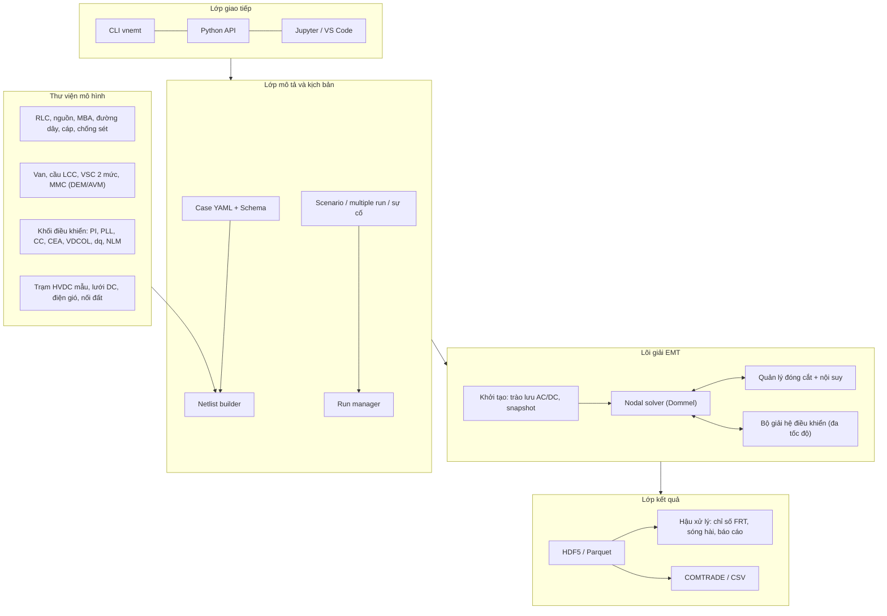

# Đặc tả phần mềm mô phỏng quá độ điện từ hệ thống điện — VnEMT v0.1

> **VnEMT** là tên tạm, có thể đổi. Tài liệu này là đặc tả yêu cầu và thiết kế khung cho phiên bản 0.1, dùng làm đầu vào cho việc phát triển với Claude Code trong VS Code (xem thư mục `.claude/`).

## Mục lục

1. [Mục đích và phạm vi](#1-mục-đích-và-phạm-vi)
2. [Tham chiếu các phần mềm mô phỏng trên thế giới](#2-tham-chiếu-các-phần-mềm-mô-phỏng-trên-thế-giới)
3. [Thuật ngữ và ký hiệu](#3-thuật-ngữ-và-ký-hiệu)
4. [Kiến trúc tổng thể](#4-kiến-trúc-tổng-thể)
5. [Lõi giải quá độ điện từ (EMT solver)](#5-lõi-giải-quá-độ-điện-từ-emt-solver)
6. [Thư viện thành phần dùng chung](#6-thư-viện-thành-phần-dùng-chung)
7. [Yêu cầu chức năng HVDC](#7-yêu-cầu-chức-năng-hvdc)
8. [Yêu cầu phi chức năng](#8-yêu-cầu-phi-chức-năng)
9. [Dữ liệu vào, kết quả ra](#9-dữ-liệu-vào-kết-quả-ra)
10. [Kiểm chứng và nghiệm thu](#10-kiểm-chứng-và-nghiệm-thu)
11. [Lộ trình phát triển](#11-lộ-trình-phát-triển)
12. [Rủi ro và giả định](#12-rủi-ro-và-giả-định)
13. [Ma trận truy xuất yêu cầu](#13-ma-trận-truy-xuất-yêu-cầu)
14. [Tài liệu tham khảo](#14-tài-liệu-tham-khảo)

---

## 1. Mục đích và phạm vi

### 1.1 Mục đích

Xây dựng một phần mềm mô phỏng quá độ điện từ (EMT) cho hệ thống điện, có tính năng tương tự PSCAD/EMTDC. Phiên bản 0.1 tập trung vào **hệ thống truyền tải điện một chiều HVDC**, phục vụ:

- nghiên cứu, đào tạo về công nghệ HVDC (gắn với giáo trình *Điện tử công suất ứng dụng trong HVDC*);
- đánh giá sơ bộ cấu hình trạm chuyển đổi, điều khiển và khả năng chịu sự cố trong giai đoạn nghiên cứu áp dụng HVDC tại Việt Nam;
- kiểm tra chéo kết quả với các phần mềm thương mại (PSCAD, EMTP, PowerFactory) trên cùng mô hình chuẩn CIGRE.

### 1.2 Phạm vi phiên bản 0.1

Tám nhóm chức năng bắt buộc theo yêu cầu đặt hàng:

| Mã | Nhóm chức năng | Mục chi tiết |
| --- | --- | --- |
| F1 | Mô phỏng hệ thống HVDC công nghệ LCC và VSC | [7.1](#71-f1--mô-phỏng-hvdc-lcc-và-vsc) |
| F2 | Mô hình hóa liên kết đa cực (monopole, symmetric monopole, bipole) | [7.2](#72-f2--liên-kết-đa-cực) |
| F3 | Điều khiển dòng điện và công suất hai chiều | [7.3](#73-f3--điều-khiển-dòng-điện-hai-chiều) |
| F4 | Mô phỏng sự cố, đánh giá khả năng chịu sự cố thoáng qua của bộ chuyển đổi | [7.4](#74-f4--mô-phỏng-sự-cố-và-đánh-giá-khả-năng-chịu-sự-cố) |
| F5 | HVDC lưỡng cực với điều khiển MBA chuyển đổi, bộ lọc AC, khả năng chịu sự cố | [7.5](#75-f5--hvdc-lưỡng-cực-mba-chuyển-đổi-và-bộ-lọc-ac) |
| F6 | Liên kết HVDC nhiều trạm (multi-terminal) | [7.6](#76-f6--liên-kết-hvdc-nhiều-trạm) |
| F7 | Mô phỏng tính toán nối đất | [7.7](#77-f7--mô-phỏng-tính-toán-nối-đất) |
| F8 | Trang trại gió ngoài khơi với bộ chuyển đổi đa mức module (MMC) | [7.8](#78-f8--trang-trại-gió-ngoài-khơi-với-mmc) |

### 1.3 Ngoài phạm vi v0.1

- Giao diện vẽ sơ đồ kéo-thả (v0.1 dùng file mô tả mạch YAML, Python API và Jupyter/VS Code; GUI ở v0.3).
- Mô phỏng thời gian thực và hardware-in-the-loop.
- Mô hình đường dây phụ thuộc tần số đầy đủ (Universal Line Model) — v0.1 dùng Bergeron và π nhiều đoạn; ULM ở v0.2.
- Phân tích ổn định RMS quy mô lớn, trào lưu công suất toàn hệ thống.
- Thiết kế bảo vệ chi tiết và mô hình máy cắt DC dạng lai đầy đủ (v0.2).
- Phân tích miền phasor (trào lưu, ngắn mạch, N-k, ổn định RMS), quy hoạch – vận hành lưới truyền tải và nghiên cứu runback/run-up HVDC: đặc tả riêng tại [SPEC-phan-tich-luoi-v0.1.md](SPEC-phan-tich-luoi-v0.1.md), lộ trình từ v0.4. Mô hình dữ liệu lưới của v0.1 phải được thiết kế để dùng chung cho phần này.

### 1.4 Đối tượng sử dụng

| Nhóm | Nhu cầu chính |
| --- | --- |
| Kỹ sư nghiên cứu, thiết kế trạm chuyển đổi | Cấu hình trạm, điều khiển, đánh giá sự cố, sóng hài |
| Kỹ sư vận hành, thí nghiệm | Hiểu đáp ứng của hệ thống, tái hiện sự kiện, đào tạo |
| Giảng viên, học viên | Mô phỏng minh họa góc kích, chuyển mạch, PWM, điều khiển vector |
| Nhà phát triển | Mở rộng thư viện mô hình, viết kịch bản tự động |

---

## 2. Tham chiếu các phần mềm mô phỏng trên thế giới

### 2.1 So sánh tính năng

| Phần mềm | Loại | Đặc điểm nổi bật | Tính năng VnEMT tham khảo |
| --- | --- | --- | --- |
| PSCAD/EMTDC (Manitoba Hydro International) | EMT offline, thương mại | Giải mạng theo phương pháp Dommel, bước cố định, nội suy thời điểm đóng cắt; thư viện HVDC LCC, VSC, MMC phong phú; chạy nhiều lần (multiple run), tối ưu tham số; snapshot khởi tạo; tự động hóa bằng Python | Lõi giải Dommel + nội suy; thư viện HVDC; multiple run; snapshot; scripting Python |
| EMTP (EMTP-RV, EDF/PowerSys) | EMT offline, thương mại | Giải trong miền thời gian, tần số và trào lưu công suất; khởi tạo từ trào lưu; mô hình đường dây, cáp, MBA có bão hòa, từ trễ; giao tiếp FMI, Simulink | Khởi tạo từ trào lưu công suất; MBA bão hòa; giao tiếp FMI (v0.3) |
| RTDS / OPAL-RT HYPERSIM | EMT thời gian thực | Thử nghiệm phần cứng điều khiển, bảo vệ (HIL) | Ngoài phạm vi v0.1; định dạng kết quả COMTRADE để trao đổi |
| DIgSILENT PowerFactory | RMS + EMT, thương mại | Kết hợp trào lưu, RMS, EMT trong một mô hình; ngắn mạch | Phân tách mô hình mạng và mô hình điều khiển; chế độ trào lưu DC/AC đơn giản |
| MATLAB Simscape Electrical | EMT/phasor, thương mại | Mô hình điều khiển trực quan; nhiều ví dụ HVDC, MMC | Thư viện khối điều khiển; ví dụ mẫu |
| ATP-EMTP | EMT, miễn phí có giấy phép | Lâu đời, nhiều mô hình quá áp, sét | Mô hình chống sét, quá điện áp (v0.2) |
| DPsim (RWTH Aachen) | Mã nguồn mở MPL-2.0 | Lõi C++, giao diện Python; miền EMT và dynamic phasor; nhập CIM/CGMES; thời gian thực tới 50 µs | Kiến trúc lõi + Python; nhập CIM (v0.3) |

Ghi chú: bảng tổng hợp từ tài liệu giới thiệu của nhà phát triển ([EMTP – EDF](https://www.edf.fr/en/the-edf-group/innovating-for-the-future/rd-global-expertise/our-offers/simulation-softwares/emtp-rv), [DPsim](https://libraries.io/pypi/dpsim)) và hiểu biết chung về các phần mềm; tính năng của từng phần mềm cần đối chiếu tài liệu chính thức của phiên bản đang dùng.

### 2.2 Mô hình chuẩn quốc tế dùng làm đích kiểm chứng

| Mô hình | Nội dung | Dùng cho |
| --- | --- | --- |
| CIGRE HVDC Benchmark (lần đầu, 1991) | Liên kết LCC đơn cực 12 xung 1000 MW, 500 kV, lưới AC yếu (SCR ≈ 2,5) | F1, F3, F4, F5 |
| CIGRE TB 604 (WG B4.57) | Hướng dẫn mô hình VSC/MMC cho nghiên cứu hệ thống, phân loại mô hình MMC theo mức chi tiết; lưới DC thử nghiệm | F1, F6, F8 |
| CIGRE TB 804 (WG B4.72) — DC grid benchmark BM1–BM7 | BM1 lưới VSC ±500 kV; BM2 lưới LCC ±800 kV; BM3 MTDC ±320 kV; **BM4 lưới DC ngoài khơi cho điện gió**; BM5 lai LCC/VSC; BM6 tập trung máy cắt DC; BM7 lưới tổng hợp > 20 trạm | F2, F6, F8 |

Theo tóm tắt của CIGRE, các mô hình TB 804 được dựng ở PSCAD (BM1–5), PowerFactory (BM6), EMTP (BM4, BM7), RTDS và HYPERSIM, nên phù hợp để so sánh chéo ([Electra 311](https://electra.cigre.org/311-august-2020/technical-brochures/dc-grid-benchmark-models-for-system-studies)).

---

## 3. Thuật ngữ và ký hiệu

| Thuật ngữ | Giải thích |
| --- | --- |
| EMT | Electromagnetic Transient — mô phỏng giá trị tức thời, bước thời gian µs |
| LCC | Line-Commutated Converter — bộ chuyển đổi chuyển mạch theo lưới, dùng thyristor |
| VSC, MMC | Voltage-Source Converter; Modular Multilevel Converter |
| SM, HB, FB | Submodule; nửa cầu (half-bridge); cầu đủ (full-bridge) |
| CC, CEA, VDCOL | Constant Current; Constant Extinction Angle; Voltage Dependent Current Order Limiter |
| PLL, EPC | Phase-Locked Loop; Equidistant Pulse Control |
| OLTC | On-Load Tap Changer — bộ chuyển nấc dưới tải |
| MTDC | Multi-terminal DC — hệ thống DC nhiều trạm |
| FRT | Fault Ride-Through — khả năng vượt qua sự cố |
| CF | Commutation Failure — sự cố chuyển mạch |
| DEM, AVM | Detailed Equivalent Model; Average Value Model |
| α, β, γ, μ | Góc kích, góc kích sớm, góc tắt, góc trùng dẫn (IEC 60633) |

Ký hiệu và công thức tuân theo giáo trình *Điện tử công suất ứng dụng trong HVDC* (cùng bộ tài liệu).

---

## 4. Kiến trúc tổng thể

### 4.1 Lựa chọn công nghệ

| Thành phần | Lựa chọn v0.1 | Lý do |
| --- | --- | --- |
| Ngôn ngữ | Python ≥ 3.11 | Dễ phát triển cùng Claude Code, hệ sinh thái khoa học mạnh |
| Tính toán số | NumPy, SciPy (`scipy.sparse`, `splu`) | Ma trận thưa, phân tích LU |
| Tăng tốc | Numba (JIT) cho vòng lặp bước thời gian và mô hình van | Đạt hiệu năng gần C mà vẫn viết Python; v0.2 xem xét lõi Rust/C++ |
| Mô tả mạch | YAML + JSON Schema | Đọc được, kiểm tra được, quản lý bằng git |
| Kết quả | HDF5 (`h5py`) hoặc Parquet; xuất COMTRADE (IEEE C37.111), CSV | Dung lượng lớn, trao đổi với phần mềm khác |
| Đồ thị | Matplotlib (báo cáo), Plotly (tương tác) | |
| Giao diện v0.1 | CLI (`vnemt run case.yaml`), Python API, Jupyter trong VS Code | GUI ở v0.3 |
| Kiểm thử | pytest, hypothesis; kiểm thử hồi quy với dạng sóng tham chiếu | |
| Hệ điều hành | Windows 10/11 (chính), Linux | Người dùng chính trên Windows |

### 4.2 Sơ đồ lớp



### 4.3 Cấu trúc mã nguồn

```text
vnemt/
├── src/vnemt/
│   ├── core/          # solver, matrix, switching, interpolation, init, snapshot
│   ├── components/    # passive, sources, transformer, lines, cables, arrester, filters
│   ├── power_electronics/  # thyristor, igbt, lcc_bridge, vsc2l, mmc (dem, avm)
│   ├── control/       # blocks, pll, lcc_control, vsc_control, mmc_control, droop
│   ├── systems/       # hvdc_lcc_bipole, mtdc, offshore_wind, cigre_benchmarks
│   ├── grounding/     # electrode, soil, dc_current_distribution
│   ├── faults/        # fault library, event scheduler
│   ├── analysis/      # frt_metrics, harmonics, filters_performance, reports
│   ├── io/            # yaml schema, hdf5, comtrade, csv
│   └── cli.py
├── cases/             # file case mẫu (CIGRE benchmark, bài thực hành)
├── tests/             # unit, analytic, regression (reference waveforms)
├── docs/              # SPEC, hướng dẫn, ghi chú mô hình
└── .claude/           # agents, skills cho Claude Code
```

---

## 5. Lõi giải quá độ điện từ (EMT solver)

### 5.1 Phương pháp

| Mã | Yêu cầu | Tiêu chí chấp nhận |
| --- | --- | --- |
| S-01 | Phân tích nút theo phương pháp Dommel: mỗi phần tử L, C được rời rạc hóa thành điện dẫn tương đương song song nguồn dòng lịch sử. Hệ phương trình `G·v(t) = i_hist(t) + i_src(t)` | Mạch RLC nối tiếp: sai số so với lời giải giải tích < 0,1 % với Δt = 1 µs |
| S-02 | Quy tắc tích phân hình thang (mặc định); cho phép chuyển nửa bước sang Euler lùi (Critical Damping Adjustment) ngay sau đóng cắt để triệt dao động số | Ngắt dòng i₀ qua cuộn cảm L bằng khóa R_off: không CDA thì dao động số duy trì; có CDA thì biên độ dư sau hai nửa bước ≤ 4·i₀·L²/(Δt²·R_off) (sai lệch ±5 %), và ≤ 1 % điện áp nguồn khi R_off ≥ 1e9 Ω. Khuyến cáo: khóa dùng để ngắt dòng cuộn cảm khai báo R_off ≥ 1e9 Ω (ghi chú 5.1.1) |
| S-03 | Bước thời gian cố định Δt cấu hình 1–100 µs; mặc định 20 µs cho LCC, 10 µs cho MMC dạng DEM | |
| S-04 | Nội suy tuyến tính thời điểm đóng cắt trong bước (zero-crossing của dòng van, thời điểm xung kích), rồi đồng bộ lại lưới thời gian | Sai số thời điểm tắt van < 1 % Δt; dạng sóng cầu 6 xung không có rung (chatter) |
| S-05 | Ma trận G thưa; chỉ phân tích lại LU khi trạng thái van đổi; lưu bộ nhớ đệm các phân tích LU theo tổ hợp trạng thái thường gặp | Thời gian chạy cầu 12 xung 1 s mô phỏng ≤ 2 phút trên laptop 4 nhân (mục tiêu, xem 8.1) |
| S-06 | Bộ giải hệ điều khiển tách riêng, giải tuần tự sau mạng điện mỗi bước (trễ một bước như PSCAD); hỗ trợ đa tốc độ (control step = k·Δt) | |
| S-07 | Phân vùng mạng tại đường dây truyền sóng (Bergeron) để giải song song từng vùng | v0.2; v0.1 chỉ cần kiến trúc cho phép |
| S-08 | Khởi tạo: (a) khởi động từ 0 với ramp nguồn; (b) từ trào lưu công suất AC/DC; (c) từ snapshot đã lưu | Hệ CIGRE benchmark đạt xác lập trong ≤ 0,5 s khi khởi tạo từ snapshot |
| S-09 | Snapshot: lưu toàn bộ trạng thái (nguồn lịch sử, trạng thái van, trạng thái điều khiển) tại thời điểm t; nạp lại để chạy nhiều kịch bản sự cố | Chạy tiếp từ snapshot cho kết quả trùng (sai lệch < 1e-9 pu) so với chạy liền |
| S-10 | Multiple run: quét tham số (vị trí sự cố, thời điểm trên sóng, điện trở sự cố, hệ số điều khiển), chạy song song bằng multiprocessing | 100 lần chạy được điều phối tự động, tổng hợp bảng chỉ số |

#### 5.1.1 Ghi chú về CDA và điện trở khóa hở (bổ sung r3)

Khi khóa hở mạch nối tiếp cuộn cảm L, nhánh L–R_off tạo một mode cứng τ = L/R_off, thường ≪ Δt. Hai nửa bước Euler lùi của CDA dập mode này đi (1 + x)⁻², với x = Δt·R_off/(2L). Phần dư sau đó bị quy tắc hình thang (không L-ổn định) giữ dao động đổi dấu mỗi bước, biên độ ≈ 4·i₀·L²/(Δt²·R_off).

Phần dư tỉ lệ nghịch với R_off, nên khóa/máy cắt dùng để ngắt dòng cuộn cảm cần R_off ≥ 1e9 Ω. Với van có snubber RC (S-14), mode này là dao động vật lý của L–C và được giải đúng. Không tăng số nửa bước Euler lùi: đó là thay đổi phương pháp tích phân. Kết quả kiểm chứng: `docs/design/M1.md` mục 5.

### 5.2 Mô hình van bán dẫn

| Mã | Yêu cầu |
| --- | --- |
| S-11 | Van hai trạng thái: R_on (mΩ), R_off (MΩ) hoặc mô hình nguồn áp V_T + R_on khi dẫn |
| S-12 | Thyristor: mở khi v_AK > V_th và có xung; tắt khi i < I_H; theo dõi thời gian áp ngược sau tắt, so với t_q để phát hiện mở lại (cơ sở phát hiện sự cố chuyển mạch) |
| S-13 | IGBT + diode ngược: điều khiển bằng tín hiệu cổng; diode dẫn tự nhiên |
| S-14 | Van tương đương cho chuỗi n thyristor nối tiếp (một khóa tương đương có snubber RC tương đương) |

---

## 6. Thư viện thành phần dùng chung

| Nhóm | Thành phần v0.1 | Ghi chú |
| --- | --- | --- |
| Nguồn | Nguồn áp ba pha lý tưởng sau tổng trở Thevenin (cho theo SCR và góc X/R); nguồn dòng; nguồn DC | Đặc trưng lưới AC bằng SCR, ESCR |
| Phần tử thụ động | R, L, C, RL, RLC; tải ba pha | |
| Máy biến áp | Một pha, ba pha hai/ba cuộn; tổ đấu Y/Y, Y/Δ (±30°); bão hòa lõi (đặc tính từ hóa từng đoạn); OLTC với bước nấc, thời gian chuyển nấc | Bắt buộc cho F5 |
| Đường dây, cáp | π tập trung; π nhiều đoạn; Bergeron (tham số phân bố, không phụ thuộc tần số) cho đường dây DC và AC | ULM ở v0.2 |
| Thiết bị đóng cắt | Máy cắt AC (cắt tại dòng qua 0), dao, khóa lý tưởng có thời điểm lập trình | |
| Chống sét | ZnO phi tuyến (đặc tính V–I từng đoạn) | Chống sét van, chống sét DC |
| Bộ lọc | Lọc đơn điều chỉnh, kép điều chỉnh, thông cao bậc 2, C-type; tụ bù song song; lọc DC | Tính tham số từ Q, bậc điều chỉnh, hệ số phẩm chất |
| Đo lường | Đo áp, dòng, P/Q, RMS, giá trị trung bình, FFT trượt, góc α/γ thực tế | |
| Điều khiển | Hằng số, cộng, nhân, PI có giới hạn và chống bão hòa tích phân, lọc bậc 1/2, trễ, bảng tra, so sánh, flip-flop, chuyển hệ abc/αβ/dq, PLL | Tương tự thư viện CSMF của PSCAD |

---

## 7. Yêu cầu chức năng HVDC

Mỗi yêu cầu có mã, mô tả, mức ưu tiên (**B** = bắt buộc v0.1, **M** = mong muốn v0.1, **T** = phiên bản sau) và tiêu chí chấp nhận.

### 7.1 F1 — Mô phỏng HVDC LCC và VSC

**LCC**

| Mã | Yêu cầu | Ưu tiên | Tiêu chí chấp nhận |
| --- | --- | --- | --- |
| F1-L01 | Cầu Graetz 6 xung gồm 6 van thyristor, mỗi van có snubber RC | B | Ud trung bình khớp `Ud = Ud0·cos α − (3/π)·Xc·Id` sai số < 1 % |
| F1-L02 | Cầu 12 xung: hai cầu 6 xung nối tiếp, cấp từ MBA Y/Y và Y/Δ | B | Phổ dòng phía lưới không còn bậc 5, 7 (< 1 % I1 khi cân bằng) |
| F1-L03 | Bộ phát xung EPC dùng PLL, tạo 12 xung cách đều 30°; tùy chọn IPC | B | Khoảng cách xung lệch < 0,1° ở xác lập |
| F1-L04 | Đo góc trùng dẫn μ, góc tắt γ thực tế của từng van mỗi chu kỳ | B | γ đo được khớp công thức `cos γ = cos β + √2·Xc·Id/U_LL` sai số < 0,5° |
| F1-L05 | Phát hiện và ghi nhận sự cố chuyển mạch (van mở lại hoặc dòng không chuyển hết) | B | Xem F4 |
| F1-L06 | Mô hình cuộn kháng san bằng, lọc DC | B | |

**VSC/MMC**

| Mã | Yêu cầu | Ưu tiên | Tiêu chí chấp nhận |
| --- | --- | --- | --- |
| F1-V01 | VSC hai mức với SPWM, SPWM + bơm bậc 3, SVPWM | B | Biên độ cơ bản điện áp dây = √3/2·ma·Ud (sai số < 1 %) trong vùng tuyến tính |
| F1-V02 | MMC nửa cầu dạng **mô hình tương đương chi tiết (DEM)**: mỗi nhánh N SM, tính điện áp từng tụ, mô hình Thevenin nhánh | B | N = 200 SM/nhánh chạy được với Δt = 20 µs |
| F1-V03 | MMC dạng **mô hình trung bình (AVM)** theo hàm đóng cắt nhánh, cho nghiên cứu hệ thống lớn | B | Sai lệch Udc, P, Q so với DEM < 2 % ở xác lập và quá độ chậm |
| F1-V04 | MMC cầu đủ (FB) và lai HB/FB | M | Chặn được dòng sự cố DC |
| F1-V05 | Điều chế mức gần nhất (NLM) + thuật toán sắp xếp cân bằng điện áp tụ | B | Dao động điện áp tụ trong ±10 % ở định mức |
| F1-V06 | Điều khiển vector dq: vòng dòng trong có bù tách kênh và bù thuận; vòng ngoài P, Udc, Q, U_AC | B | Thời gian tăng id ≈ 2,2·τ; ghép chéo < 5 % khi có bù tách kênh |
| F1-V07 | Bộ triệt dòng vòng (CCSC) | B | Biên độ dòng vòng bậc 2 giảm > 80 % khi bật |
| F1-V08 | PLL hệ dq (SRF-PLL); tùy chọn DSOGI-PLL khi lưới mất cân bằng | B | |
| F1-V09 | Điều khiển tạo lưới (grid-forming) cho trạm ngoài khơi (V/f) | B (cho F8) | |

Phân loại mức chi tiết mô hình MMC tham khảo cách phân loại trong CIGRE TB 604; VnEMT v0.1 cung cấp tối thiểu hai mức DEM và AVM.

### 7.2 F2 — Liên kết đa cực

| Mã | Yêu cầu | Ưu tiên | Tiêu chí chấp nhận |
| --- | --- | --- | --- |
| F2-01 | Cấu hình đơn cực về đất (ground return) và đơn cực dây kim loại hồi (metallic return) | B | |
| F2-02 | Đơn cực đối xứng (symmetric monopole, ±Ud) cho VSC | B | |
| F2-03 | Lưỡng cực (bipole) với điện cực nối đất ở hai đầu; chế độ cân bằng và mất cân bằng | B | Dòng đất ≈ 0 ở chế độ cân bằng |
| F2-04 | Chuyển chế độ khi mất một cực: lưỡng cực → đơn cực về đất → đơn cực dây kim loại hồi (thao tác MRTB, GRTS) | M | Chuỗi thao tác chạy được trong một lần mô phỏng |
| F2-05 | Mỗi cực có thể gồm 1 hoặc 2 nhóm van 12 xung nối tiếp (cấu hình 24 xung tương đương cho UHVDC) | M | |
| F2-06 | Mô hình đường dây DC lưỡng cực có ghép hỗ cảm giữa hai cực (Bergeron nhiều dây) | B | Thấy điện áp cảm ứng lên cực lành khi sự cố cực kia |

### 7.3 F3 — Điều khiển dòng điện hai chiều

| Mã | Yêu cầu | Ưu tiên | Tiêu chí chấp nhận |
| --- | --- | --- | --- |
| F3-01 | LCC: điều khiển dòng không đổi (CC) ở chỉnh lưu, CEA (phản hồi và dự đoán) ở nghịch lưu, CC dự phòng với biên dòng ΔId | B | Đặc tính Ud–Id mô phỏng khớp đặc tính lý thuyết; hoán đổi vai trò khi U_AC chỉnh lưu giảm |
| F3-02 | VDCOL với đặc tính cấu hình được, hằng số thời gian tăng/giảm riêng | B | |
| F3-03 | Giới hạn αmin, αmax, γmin; điều khiển điện áp DC tùy chọn ở nghịch lưu | B | |
| F3-04 | **Đảo chiều công suất LCC**: đảo cực tính điện áp bằng chuỗi lệnh phối hợp hai trạm (giảm dòng, đổi vai trò, tăng điện áp ngược, khôi phục dòng) | B | Đảo chiều 1 pu → −1 pu không sự cố chuyển mạch, thời gian cấu hình |
| F3-05 | **Đảo chiều công suất VSC**: đổi dấu P* với dốc cấu hình, Udc giữ nguyên | B | |
| F3-06 | Điều khiển công suất (P_ref → Id_ref = P_ref/Ud), điều khiển tần số, hỗ trợ cản dao động (POD) | M | |
| F3-07 | Kênh viễn thông giữa hai trạm có trễ cấu hình; chế độ mất kênh viễn thông | M | |

### 7.4 F4 — Mô phỏng sự cố và đánh giá khả năng chịu sự cố

**Thư viện sự cố**

| Mã | Loại sự cố | Tham số |
| --- | --- | --- |
| F4-01 | Sự cố AC: một pha, hai pha, hai pha chạm đất, ba pha tại thanh cái hoặc điểm bất kỳ | Điện trở sự cố, thời điểm trên sóng, thời gian tồn tại, cắt bằng máy cắt |
| F4-02 | Sụt áp AC có kiểm soát (voltage dip) theo độ sâu và thời gian | Dùng để kiểm tra FRT |
| F4-03 | Sự cố DC: cực chạm đất, cực–cực, tại vị trí bất kỳ trên đường dây | Khoảng cách, điện trở |
| F4-04 | Sự cố trong trạm: ngắn mạch van, ngắn mạch qua cầu, mất xung kích, kích nhầm (misfire) | |
| F4-05 | Sự cố trong MMC: hỏng SM, ngắn mạch nhánh | M |
| F4-06 | Lịch sự kiện: chuỗi sự kiện có thời điểm (đóng cắt lọc, chuyển nấc, đổi điểm đặt, sự cố) | B |

**Logic phục hồi sự cố**

| Mã | Yêu cầu | Ưu tiên |
| --- | --- | --- |
| F4-07 | Xử lý sự cố đường dây DC của LCC: cưỡng bức nghịch lưu (force retard α ≈ 120–150°), chờ khử ion, khởi động lại, số lần thử cấu hình | B |
| F4-08 | Chống sự cố chuyển mạch: tăng γ khi phát hiện sụt áp AC (CFPREV) | B |
| F4-09 | VSC: giới hạn dòng khi sự cố AC, ưu tiên dòng phản kháng; khóa (block) khi sự cố DC với HB | B |
| F4-10 | Điện trở hãm DC (chopper) ở trạm bờ cho hệ điện gió ngoài khơi | B (cho F8) |

**Chỉ số đánh giá khả năng chịu sự cố thoáng qua** (tính tự động sau mỗi lần chạy)

| Chỉ số | Định nghĩa |
| --- | --- |
| Số lần sự cố chuyển mạch | Đếm theo van, theo trạm |
| Thời gian phục hồi | Từ khi loại trừ sự cố đến khi P đạt 90 % trị trước sự cố (mục tiêu thường gặp 100–300 ms; ngưỡng do người dùng nhập) |
| Dòng đỉnh van, dòng đỉnh DC | So với khả năng chịu dòng của van (nhập từ dữ liệu thiết bị) |
| Quá điện áp | Đỉnh điện áp DC, điện áp van, điện áp tụ SM, điện áp AC tạm thời |
| Năng lượng chống sét | Năng lượng hấp thụ của từng chống sét (kJ) |
| Năng lượng điện trở hãm | Cho F8 |
| Đạt/không đạt | So với ngưỡng cấu hình trong file tiêu chí |

Sản phẩm: bảng tổng hợp cho quét nhiều sự cố (multiple run), xuất CSV và báo cáo Markdown/HTML.

### 7.5 F5 — HVDC lưỡng cực, MBA chuyển đổi và bộ lọc AC

| Mã | Yêu cầu | Ưu tiên | Tiêu chí chấp nhận |
| --- | --- | --- | --- |
| F5-01 | Mô hình hệ lưỡng cực LCC hoàn chỉnh: hai cực, mỗi cực một nhóm 12 xung, đường dây DC, điện cực nối đất | B | Chạy được CIGRE benchmark mở rộng thành lưỡng cực |
| F5-02 | MBA chuyển đổi một pha ba cuộn hoặc ba pha hai cuộn, tổ đấu Y/Y – Y/Δ, có bão hòa, có OLTC | B | |
| F5-03 | **Điều khiển nấc MBA**: chỉnh lưu giữ α trong dải (ví dụ 12,5–17,5°); nghịch lưu giữ γ hoặc Ud; vùng chết, trễ thời gian, chống dao động nấc | B | Sau thay đổi U_AC 5 %, nấc chuyển và α quay lại dải trong thời gian cấu hình |
| F5-04 | Bộ lọc AC: nhiều nhóm lọc kép điều chỉnh (11/13, 24/36), thông cao, C-type; tụ bù | B | |
| F5-05 | Điều khiển công suất phản kháng: đóng/cắt nhóm lọc theo Q hoặc U_AC, có trễ và chống đóng cắt lặp | B | Cân bằng Q trạm trong dải cấu hình |
| F5-06 | Đánh giá **tác dụng của bộ lọc**: THD điện áp, Dn từng bậc, chỉ số ảnh hưởng điện thoại (TIF/IT) tại thanh cái AC, theo hướng dẫn IEC TR 62001 | B | Bảng sóng hài có/không có lọc |
| F5-07 | Quét tổng trở lưới theo tần số tại thanh cái trạm (frequency scan) để kiểm tra cộng hưởng lọc–lưới | M | |
| F5-08 | Khả năng chịu sự cố khi đóng/cắt lọc, mất một nhóm lọc, sự cố AC gần trạm | B | Dùng chỉ số mục 7.4 |

### 7.6 F6 — Liên kết HVDC nhiều trạm

| Mã | Yêu cầu | Ưu tiên | Tiêu chí chấp nhận |
| --- | --- | --- | --- |
| F6-01 | Lưới DC hình tia và mạch vòng với tối thiểu 4 trạm VSC | B | Dựng được mô hình tương tự CIGRE TB 804 BM3 |
| F6-02 | Điều khiển phối hợp: một trạm giữ Udc (master), droop Udc–P (đa trạm), biên điện áp | B | Mất trạm giữ Udc, các trạm còn lại vẫn ổn định với droop |
| F6-03 | MTDC LCC ba trạm (song song) với phối hợp dòng đặt | M | |
| F6-04 | Hệ lai LCC/VSC | T | Tham chiếu BM5 |
| F6-05 | Máy biến đổi DC/DC liên kết hai cấp điện áp | T | |
| F6-06 | Máy cắt DC dạng lý tưởng có thời gian cắt và năng lượng chống sét; v0.2 mô hình lai | M | |
| F6-07 | Trào lưu công suất DC (Newton–Raphson) để khởi tạo lưới nhiều trạm | B | |

### 7.7 F7 — Mô phỏng tính toán nối đất

| Mã | Yêu cầu | Ưu tiên | Tiêu chí chấp nhận |
| --- | --- | --- | --- |
| F7-01 | Mô hình đất đồng nhất và hai lớp (điện trở suất, chiều dày lớp trên) | B | |
| F7-02 | Tính điện trở điện cực nối đất: bán cầu, thanh ngang, vòng (ring), cụm điện cực; công thức giải tích và phương pháp phần tử biên đơn giản (BEM) | B | Bán cầu: R = ρ/(2πr), sai số < 1 % |
| F7-03 | Phân bố thế trên mặt đất quanh điện cực DC, điện áp bước, điện áp tiếp xúc, mật độ dòng tại bề mặt điện cực | B | Bản đồ thế 2D, so với ngưỡng nhập |
| F7-04 | Tích hợp điện trở điện cực vào mô phỏng EMT (chế độ đơn cực về đất, mất cân bằng lưỡng cực) | B | |
| F7-05 | Ước tính dòng DC đi vào trung tính MBA trạm AC lân cận (DC bias) theo mạng điện trở tương đương | M | Bảng dòng DC từng trạm AC |
| F7-06 | Nhiệt độ điện cực theo thời gian vận hành đơn cực về đất | T | |

Căn cứ thiết kế điện cực nối đất HVDC: IEC TS 62344.

### 7.8 F8 — Trang trại gió ngoài khơi với MMC

| Mã | Yêu cầu | Ưu tiên | Tiêu chí chấp nhận |
| --- | --- | --- | --- |
| F8-01 | Mô hình turbine gió tổng hợp (aggregated) loại 4 (biến đổi toàn phần), mức trung bình: đặc tính công suất theo gió, giới hạn dòng, FRT | B | |
| F8-02 | Lưới góp AC ngoài khơi (66 kV), MBA nâng áp giàn | B | |
| F8-03 | MMC ngoài khơi chế độ tạo lưới (V/f), MMC trên bờ giữ Udc và Q | B | Tần số lưới ngoài khơi ổn định ±0,5 % khi gió thay đổi bước |
| F8-04 | Cáp DC ngầm (π nhiều đoạn hoặc Bergeron) cấu hình đơn cực đối xứng | B | |
| F8-05 | FRT khi sự cố AC trên bờ: điện trở hãm DC hấp thụ công suất thừa, hoặc giảm công suất turbine qua tín hiệu/điều khiển tần số | B | Udc không vượt 1,1 pu (ngưỡng cấu hình) |
| F8-06 | Sự cố AC ngoài khơi, sự cố DC cực–đất | B | |
| F8-07 | Mô hình theo CIGRE TB 804 BM4 (rút gọn) làm case mẫu | M | |

---

## 8. Yêu cầu phi chức năng

### 8.1 Hiệu năng (mục tiêu, kiểm lại sau mốc M2)

| Mã | Tình huống | Mục tiêu |
| --- | --- | --- |
| P-01 | Lưỡng cực LCC 12 xung (CIGRE mở rộng), Δt = 20 µs, 1 s mô phỏng | ≤ 2 phút |
| P-02 | MMC DEM 200 SM/nhánh, điểm–điểm, Δt = 20 µs, 1 s | ≤ 10 phút |
| P-03 | MMC AVM, lưới 4 trạm, 2 s | ≤ 2 phút |
| P-04 | Quét 100 sự cố từ snapshot | Chạy song song theo số nhân CPU |

### 8.2 Chất lượng

| Mã | Yêu cầu |
| --- | --- |
| Q-01 | Mọi mô hình có kiểm thử đơn vị và ít nhất một kiểm thử so với lời giải giải tích hoặc dạng sóng tham chiếu |
| Q-02 | Kết quả tái lập được: cùng file case, cùng phiên bản → cùng kết quả (sai lệch < 1e-9) |
| Q-03 | Mỗi file case lưu kèm phiên bản phần mềm, mã băm thư viện, tham số solver trong kết quả |
| Q-04 | Đơn vị: SI trong lõi; hệ đơn vị tương đối (pu) chỉ ở lớp điều khiển và báo cáo, có khai báo cơ bản rõ ràng |
| Q-05 | Thông báo lỗi bằng tiếng Việt, chỉ rõ phần tử và tham số gây lỗi; tài liệu song ngữ Việt – Anh cho thuật ngữ |
| Q-06 | Mã nguồn: kiểu tĩnh (type hints, mypy), ruff, docstring theo NumPy style, độ phủ kiểm thử ≥ 80 % cho `core/` |

### 8.3 Bảo mật và dữ liệu

Dữ liệu thiết bị của dự án thực tế (thông số MBA, van, điều khiển của nhà cung cấp) được để trong thư mục `private/` không đưa lên kho mã chung; file case tham chiếu bằng đường dẫn.

---

## 9. Dữ liệu vào, kết quả ra

### 9.1 File mô tả case (YAML)

```yaml
case:
  name: cigre_lcc_bipole
  solver: {dt_us: 20, t_end_s: 1.5, method: trapezoidal, cda: true}
  init: {mode: snapshot, file: snapshots/cigre_bipole_t1.h5}
base: {S_MVA: 1000, U_dc_kV: 500, f_Hz: 50}
ac_systems:
  - id: AC_R
    U_kV: 345
    scr: 2.5
    angle_deg: 84
converter_stations:
  - id: REC_P
    type: lcc_12pulse
    pole: positive
    transformer: {S_MVA: 603.7, U1_kV: 345, U2_kV: 213.4, xk_pu: 0.18, oltc: {steps: [-10, 10], step_pct: 1.25}}
    control: {mode: CC, alpha_min_deg: 5, vdcol: {u_low: 0.3, u_high: 0.7, i_low: 0.3}}
    filters: [{type: double_tuned, h: [11, 13], Q_Mvar: 150}, {type: high_pass, h: 24, Q_Mvar: 100}]
dc_network:
  lines: [{id: L1, from: REC_P, to: INV_P, model: bergeron, length_km: 300}]
  grounding: {electrodes: [{id: E_R, type: ring, radius_m: 300, soil: {model: two_layer, rho1: 100, rho2: 1000, h1_m: 20}}]}
events:
  - {t_s: 1.0, type: ac_fault, location: AC_I, kind: 3ph, r_ohm: 0.1, duration_ms: 100}
outputs:
  signals: [REC_P.Id, REC_P.alpha, INV_P.gamma, INV_P.Ud, AC_I.Urms]
  format: [hdf5, comtrade, pscad_out]
criteria: {recovery_90pct_ms: 200, max_cf: 1}
```

Toàn bộ khóa được kiểm tra bằng JSON Schema trước khi chạy; lỗi được báo theo đường dẫn khóa.

### 9.2 Kết quả

| Định dạng | Nội dung |
| --- | --- |
| HDF5 / Parquet | Toàn bộ tín hiệu được chọn, metadata case, phiên bản |
| COMTRADE (IEEE C37.111) | Trao đổi với phần mềm phân tích sự cố, rơle |
| CSV | Chỉ số tổng hợp của multiple run |
| Markdown / HTML | Báo cáo tự động: thông số, đồ thị, bảng chỉ số FRT, kết luận đạt/không đạt |

---

### 9.3 Trao đổi dữ liệu với PSCAD và phần mềm khác

Mục tiêu: kết quả và mô hình của VnEMT dùng được trong PSCAD và ngược lại, để so sánh chéo (cấp kiểm chứng V4) và để kỹ sư không phải dựng lại mô hình hai lần. Trao đổi chia hai loại có độ khó rất khác nhau:

- **Kết quả mô phỏng (dạng sóng):** định dạng được công bố, chuyển đổi đầy đủ hai chiều — làm ngay ở v0.1.
- **Mô hình (sơ đồ mạch, tham số, điều khiển):** định dạng dự án PSCAD không có đặc tả công khai đầy đủ, mô hình người dùng viết bằng Fortran/C hoặc Blackbox không chuyển được — làm theo mức độ, từ v0.2.

#### 9.3.1 Các định dạng của PSCAD

| File PSCAD | Nội dung | Tình trạng tài liệu | Cách VnEMT xử lý |
| --- | --- | --- | --- |
| `.out` + `.inf` (kết quả, kiểu cũ) | File văn bản dạng cột: cột 1 là thời gian, mỗi file tối đa 10 kênh; `.inf` mô tả tên kênh, nhóm, đơn vị, min, max; tên file `<namespace>_r##_m#####_##.out` | Được mô tả trong trợ giúp PSCAD | **Xuất và nhập trực tiếp** |
| `.psout` (kết quả, từ V5) | File nhị phân gom mọi kênh và mọi lần chạy (kể cả chạy song song) | Không đọc trực tiếp; MHI cung cấp thư viện Python `mhi-psout` (BSD-3-Clause-Clear, bản dựng sẵn cho Windows) | **Nhập** qua `mhi-psout` (phụ thuộc tùy chọn); không xuất |
| COMTRADE (từ khối COMTRADE Recorder) | Chuẩn COMTRADE 1999, tối đa 12 kênh analog + 16 kênh số mỗi khối | Chuẩn mở IEEE C37.111 | **Xuất và nhập** |
| `.pscx` (dự án), `.pslx` (thư viện), `.pswx` (workspace) | XML: định nghĩa component, schematic, component với `params`, dây nối có `vertex` | Chỉ có API Python của MHI (`mhi.xml.pscad`, `mhi-pscad`), không có đặc tả lược đồ đầy đủ | **Theo mức độ** (bảng 9.3.3), ưu tiên đi qua thư viện tự động hóa của MHI |
| Mã Fortran/C người dùng, Blackbox (`.lib`, `.obj`) | Mô hình đóng gói, thường là điều khiển của nhà cung cấp | Mã đóng | **Không chuyển đổi.** Thay bằng khối tương đương của VnEMT hoặc co-simulation (v0.3) |

#### 9.3.2 Yêu cầu trao đổi kết quả (v0.1)

| Mã | Yêu cầu | Ưu tiên | Tiêu chí chấp nhận |
| --- | --- | --- | --- |
| IO-01 | Xuất COMTRADE theo IEEE C37.111-1999 và 2013 (ASCII và nhị phân), kênh analog và số, hệ số tỷ lệ, tần số lấy mẫu | B | Mở được trong Enerplot và một phần mềm phân tích sự cố độc lập; dạng sóng trùng khớp (sai lệch do lượng tử hóa < 0,05 % toàn thang) |
| IO-02 | Nhập COMTRADE 1991/1999/2013: dùng làm dạng sóng tham chiếu để so sánh, hoặc làm nguồn phát lại (playback) đưa vào mô phỏng | B | Đọc đúng file do PSCAD COMTRADE Recorder tạo ra |
| IO-03 | Xuất kết quả theo định dạng PSCAD `.out` + `.inf`: chia file 10 kênh/file, đặt tên theo quy ước PSCAD, ghi tên kênh, nhóm, đơn vị | B | Enerplot mở được; tên kênh hiển thị đúng |
| IO-04 | Nhập `.out` + `.inf` của PSCAD (kể cả nhiều file, nhiều lần chạy) | B | Ánh xạ đúng kênh theo công thức cột/file của PSCAD |
| IO-05 | Nhập `.psout` qua `mhi-psout` nếu có cài; báo rõ khi thiếu thư viện và gợi ý dùng PSOUT Reader chuyển sang `.out` | M | Đọc được nhiều lần chạy trong một file |
| IO-06 | Công cụ so sánh dạng sóng VnEMT – phần mềm khác: đồng bộ thời gian, nội suy về cùng lưới thời gian, tính sai lệch đỉnh, RMS, thời điểm vượt ngưỡng, thời gian phục hồi | B | Dùng cho cấp kiểm chứng V4 (mục 10) |
| IO-07 | Xuất CSV, HDF5, MATLAB `.mat` | B | `.mat` mở được bằng MATLAB/Octave |

#### 9.3.3 Yêu cầu trao đổi mô hình với PSCAD (v0.2)

Mức độ trung thực khi chuyển mô hình:

| Mức | Nội dung chuyển được | Ghi chú |
| --- | --- | --- |
| L1 | Cấu trúc lưới và phần tử thụ động: nguồn, R/L/C, tải, MBA, máy cắt, sự cố, đường dây π/Bergeron, nút đo | Mục tiêu đầu tiên |
| L2 | L1 + bộ chuyển đổi chuẩn: cầu 6/12 xung, van, lọc AC/DC, MMC thư viện | Ánh xạ sang component tương ứng trong thư viện master của PSCAD |
| L3 | L2 + khối điều khiển chuẩn: PI, giới hạn, PLL, biến đổi abc/dq, bảng tra | Chỉ với khối có tương đương trực tiếp |
| L4 | Điều khiển viết bằng mã, Blackbox, component do người dùng tự định nghĩa | **Không hỗ trợ**; báo danh sách phần tử bỏ qua |

| Mã | Yêu cầu | Ưu tiên | Tiêu chí chấp nhận |
| --- | --- | --- | --- |
| IO-10 | **Xuất sang PSCAD** qua thư viện tự động hóa `mhi-pscad`: VnEMT tạo dự án, đặt component, nối dây, gán tham số trong PSCAD đang chạy (Windows, có PSCAD V5 và giấy phép) | M (v0.2) | Case CIGRE LCC benchmark mức L2 dựng được trong PSCAD, chạy không lỗi |
| IO-11 | **Nhập từ PSCAD**: đọc `.pscx` (XML) ở mức L1–L2: danh sách component, tham số, kết nối; phần tử không ánh xạ được ghi vào báo cáo | M (v0.2) | Nhập dự án mẫu của PSCAD, báo cáo đầy đủ phần tử đã chuyển và bị bỏ qua |
| IO-12 | Bảng ánh xạ component VnEMT ↔ PSCAD lưu dạng YAML (`io/mappings/pscad_master.yaml`): tên định nghĩa, tham số, đơn vị, quy đổi | B (khi làm IO-10/11) | Mỗi dòng ánh xạ có kiểm thử khứ hồi tham số |
| IO-13 | Kiểm thử khứ hồi: case VnEMT → dự án PSCAD → chạy PSCAD → `.psout` → so sánh với VnEMT bằng IO-06, tự động bằng script | M (v0.2) | Báo cáo sai lệch theo bảng V4 |
| IO-14 | Không tự sửa file `.pscx` gốc; luôn ghi ra file mới; ghi phiên bản PSCAD đích | B | |

Ghi chú: đọc/ghi `.pscx` trực tiếp bằng XML không qua thư viện MHI là phương án dự phòng; cấu trúc XML có thể thay đổi giữa các phiên bản PSCAD, phải kiểm thử trên file mẫu của đúng phiên bản đang dùng.

#### 9.3.4 Phần mềm khác

| Phần mềm / chuẩn | Định dạng | Hướng | Dùng cho | Phiên bản VnEMT |
| --- | --- | --- | --- | --- |
| Mọi phần mềm phân tích sự cố, rơle, RTDS, EMTP, PowerFactory | COMTRADE (IEEE C37.111 / IEC 60255-24) | Hai chiều | Dạng sóng | v0.1 |
| Enerplot (MHI) | `.out/.inf`, COMTRADE, CSV | VnEMT → Enerplot | Xem, xử lý kết quả | v0.1 |
| MATLAB / Octave / Python | `.mat`, HDF5, CSV | Hai chiều | Hậu xử lý | v0.1 |
| PSS/E (Siemens) — mục tiêu bản 36, đọc ngược 35/34/33 | RAW và SEQ; RAWX, DYR, SUB/MON/CON, `.out`, `.sav` qua `psspy` | Nhập (RAW, RAWX xuất từ v0.4) | Lưới AC, trào lưu khởi tạo, ngắn mạch không đối xứng; chi tiết tại SPEC-phan-tich-luoi mục 7 | v0.2 (RAW, SEQ) |
| PowerFactory (DIgSILENT) | DGS (dạng ASCII/CSV) | Nhập | Lưới AC, số liệu thiết bị | v0.3 |
| Chuẩn CIM / CGMES (IEC 61970-452, -600) | XML/RDF, gồm cả hồ sơ thiết bị DC | Nhập (v0.3), xuất (sau) | Trao đổi mô hình lưới với đơn vị vận hành | v0.3 |
| ATP-EMTP | File dữ liệu `.atp` (văn bản cột cố định) | Xuất | Mạng thụ động để so sánh chéo | v0.3 |
| FMI 2.0 / 3.0 | FMU | Nhập (co-simulation) và xuất khối điều khiển | Dùng mô hình điều khiển của bên thứ ba; EMTP hỗ trợ FMI | v0.3 |

Thứ tự ưu tiên: COMTRADE và `.out/.inf` trước vì phổ biến, công bố đầy đủ, đủ để so sánh chéo với PSCAD; mô hình PSCAD sau vì phụ thuộc thư viện MHI và giấy phép PSCAD.

---

## 10. Kiểm chứng và nghiệm thu

### 10.1 Các cấp kiểm chứng

| Cấp | Nội dung | Ví dụ |
| --- | --- | --- |
| V1 — Giải tích | So với lời giải đóng | Mạch RLC; cầu 6 xung: Ud, μ, γ theo giáo trình Chương 6–7; SPWM: √3/2·ma·Ud; điện trở điện cực bán cầu |
| V2 — Hội tụ | Giảm Δt một nửa, sai lệch giảm đúng bậc | Sai lệch Ud, Id khi Δt 50 → 25 → 12,5 µs |
| V3 — Mô hình chuẩn | Tái hiện mô hình CIGRE | CIGRE HVDC benchmark: Id, α, γ xác lập; đáp ứng sự cố ba pha phía nghịch lưu |
| V4 — So sánh chéo | Cùng mô hình trên PSCAD/EMTP (nếu đơn vị có bản quyền) | Sai lệch đỉnh dòng, thời gian phục hồi trong ±5 % |
| V5 — Nhất quán mô hình | DEM so với AVM | Sai lệch < 2 % các đại lượng hệ thống |

### 10.2 Bộ case nghiệm thu v0.1

| Case | Chức năng kiểm | Tiêu chí |
| --- | --- | --- |
| TC-01 cầu 6 xung, quét α 0–150° | F1-L01, F1-L04 | Ud, μ, γ khớp công thức |
| TC-02 CIGRE LCC benchmark đơn cực | F1, F3-01 | Xác lập đúng điểm làm việc thiết kế |
| TC-03 Sụt áp nghịch lưu 10–30 % | F4 | Đếm CF; CFPREV giảm số CF |
| TC-04 Lưỡng cực có OLTC và lọc | F5 | Nấc và Q trạm đáp ứng đúng; bảng sóng hài |
| TC-05 Đảo chiều công suất LCC và VSC | F3-04, F3-05 | Không CF; dốc đúng |
| TC-06 Lưới VSC 4 trạm, mất trạm master | F6 | Ổn định với droop |
| TC-07 Điện cực vòng, đất hai lớp | F7 | Điện trở, điện áp bước so với tính tay |
| TC-08 Điện gió ngoài khơi, sự cố AC trên bờ | F8 | Udc ≤ ngưỡng nhờ điện trở hãm |
| TC-09 Quét 50 sự cố từ snapshot | S-09, S-10 | Bảng chỉ số đầy đủ |
| TC-10 Xuất/nhập kết quả | IO-01…IO-07 | Xuất COMTRADE và `.out/.inf`, nhập lại, sai lệch < 0,05 %; mở được trong Enerplot |

---

## 11. Lộ trình phát triển

| Mốc | Nội dung | Kết quả |
| --- | --- | --- |
| M0 | Khung dự án, CI, schema YAML, đọc case, ghi HDF5 | `vnemt run` chạy mạch RLC |
| M1 | Lõi giải Dommel, khóa lý tưởng, nội suy, CDA, snapshot | V1, V2 cho mạch thụ động và chỉnh lưu diode |
| M2 | LCC: thyristor, cầu 6/12 xung, MBA Y/Δ, EPC/PLL, CC/CEA/VDCOL | TC-01, TC-02 |
| M3 | Sự cố, lịch sự kiện, chỉ số FRT, multiple run; trao đổi kết quả IO-01…IO-07 | TC-03, TC-09, TC-10 |
| M4 | Lưỡng cực, OLTC, lọc AC, sóng hài, đảo chiều LCC | TC-04, TC-05 (LCC) |
| M5 | VSC 2 mức, MMC DEM/AVM, điều khiển dq, CCSC | TC-05 (VSC) |
| M6 | MTDC, droop, trào lưu DC | TC-06 |
| M7 | Nối đất | TC-07 |
| M8 | Điện gió ngoài khơi | TC-08 |
| M9 | Tài liệu, ví dụ, phát hành v0.1 | Bộ nghiệm thu đạt |
| v0.2 | ULM, song song hóa theo vùng, máy cắt DC lai, DC/DC; trao đổi mô hình PSCAD IO-10…IO-14; nhập PSS/E RAW | |
| v0.3 | GUI sơ đồ, nhập CIM/CGMES, DGS, xuất ATP, FMI | |
| v0.4–v1.0 | Phân tích lưới miền phasor, quy hoạch – vận hành, runback/run-up, lai RMS–EMT | Xem SPEC-phan-tich-luoi-v0.1 mục 8 |

Thứ tự M5–M8 có thể đổi theo ưu tiên của đơn vị sử dụng.

---

## 12. Rủi ro và giả định

| Rủi ro | Ảnh hưởng | Giảm thiểu |
| --- | --- | --- |
| Python chậm với MMC DEM số SM lớn | Không đạt P-02 | Numba; mô hình tương đương nhánh; v0.2 lõi Rust/C++ |
| Thiếu dữ liệu tham chiếu PSCAD | Khó nghiệm thu V4 | Dùng V1–V3, V5; ưu tiên mô hình CIGRE có dữ liệu công bố |
| Dao động số khi đóng cắt dày | Kết quả sai | CDA, nội suy, kiểm thử hội tụ bắt buộc |
| Thông số thiết bị thực tế bảo mật | Không chia sẻ được case | Thư mục `private/`, case mẫu dùng số liệu CIGRE |
| Phạm vi rộng so với nhân lực (một người + Claude Code) | Trễ mốc | Làm tuần tự theo mốc; mỗi mốc có case nghiệm thu rõ |

Giả định: lưới AC biểu diễn bằng nguồn Thevenin hoặc mạng rút gọn; turbine gió dùng mô hình trung bình; không mô hình chi tiết vật lý linh kiện.

---

## 13. Ma trận truy xuất yêu cầu

| Nhóm | Module chính | Agent phụ trách (Claude Code) | Case nghiệm thu |
| --- | --- | --- | --- |
| Lõi giải S-xx | `core/` | `emt-solver-engineer` | V1, V2, TC-09 |
| F1 LCC | `power_electronics/lcc_*`, `control/lcc_control` | `lcc-modeler`, `hvdc-control-engineer` | TC-01, TC-02 |
| F1 VSC/MMC | `power_electronics/vsc2l, mmc` | `vsc-mmc-modeler`, `hvdc-control-engineer` | TC-05 |
| F2 đa cực | `systems/hvdc_lcc_bipole` | `lcc-modeler` | TC-04 |
| F3 hai chiều | `control/*` | `hvdc-control-engineer` | TC-05 |
| F4 sự cố | `faults/`, `analysis/frt_metrics` | `fault-study-engineer` | TC-03, TC-09 |
| F5 lưỡng cực, MBA, lọc | `components/transformer, filters`, `analysis/harmonics` | `lcc-modeler`, `fault-study-engineer` | TC-04 |
| F6 nhiều trạm | `systems/mtdc` | `vsc-mmc-modeler`, `hvdc-control-engineer` | TC-06 |
| F7 nối đất | `grounding/` | `grounding-engineer` | TC-07 |
| F8 điện gió | `systems/offshore_wind` | `offshore-wind-modeler` | TC-08 |
| Trao đổi dữ liệu IO-xx | `io/` | `interop-engineer` | TC-10, IO-13 |
| Kiến trúc, schema | toàn bộ | `emt-architect` | M0 |
| Kiểm chứng | `tests/` | `validation-engineer` | Tất cả |

---

## 14. Tài liệu tham khảo

1. H. W. Dommel, "Digital computer solution of electromagnetic transients in single- and multiphase networks", *IEEE Trans. PAS*, vol. 88, no. 4, 1969.
2. Manitoba Hydro International, *PSCAD User's Guide* (v4.6 / V5), [pscad.com](https://www.pscad.com/uploads/ck/files/PSCAD%20Users%20Guide%20V4_6_0.pdf).
3. EDF, *EMTP-RV* — giới thiệu năng lực, [edf.fr](https://www.edf.fr/en/the-edf-group/innovating-for-the-future/rd-global-expertise/our-offers/simulation-softwares/emtp-rv).
4. DPsim — dynamic real-time power system simulator, [libraries.io/pypi/dpsim](https://libraries.io/pypi/dpsim).
5. M. Szechtman, T. Wess, C. V. Thio, "A benchmark model for HVDC system studies", *Proc. IEE Int. Conf. AC and DC Power Transmission*, 1991.
6. CIGRE TB 604, *Guide for the development of models for HVDC converters in a HVDC grid*, WG B4.57, 2014.
7. CIGRE TB 804, *DC grid benchmark models for system studies*, WG B4.72, 2020 — tóm tắt tại [Electra 311](https://electra.cigre.org/311-august-2020/technical-brochures/dc-grid-benchmark-models-for-system-studies).
8. IEC 60633, *HVDC transmission — Vocabulary*.
9. IEC TR 62001 (các phần), *HVDC systems — Guidance to the specification and design evaluation of AC filters*.
10. IEC TS 62344, *Design of earth electrode stations for HVDC links — General guidelines*.
11. IEC 60919-1/-2/-3, *Performance of HVDC systems with line-commutated converters* (xác lập, quá độ, động).
12. IEEE C37.111 (1999, 2013) / IEC 60255-24, *COMTRADE — Common format for transient data exchange*.
16. MHI, *EMTDC Output Files* (định dạng `.out`, `.inf`, `.psout`), [pscad.com](https://www.pscad.com/webhelp-v5-ol/PSCAD/Features_and_Operations/EMTDC_Output_Files.htm).
17. MHI, *COMTRADE Recorder*, [pscad.com](https://www.pscad.com/webhelp-pscad-v5.1.0-ol/Master_Library_Models/Meters/COMTRADE_Recorder/COMTRADE_Recorder.htm).
18. MHI, gói Python `mhi-psout`, [pypi.org](https://pypi.org/project/mhi-psout) và `mhi-pscad`, [pypi.org](https://pypi.org/project/mhi-pscad/3.1.0/); API XML dự án, [pscad.com](https://www.pscad.com/webhelp-automation-library-v1.0.2/xml/pscad/project.html).
19. MHI, *Enerplot — Supported Data File Types*, [pscad.com](https://www.pscad.com/enerplot/Enerplot/The_Application_Environment/Supported_Data_File_Types.htm).
13. A. Yazdani, R. Iravani, *Voltage-Sourced Converters in Power Systems*, Wiley-IEEE, 2010.
14. K. Sharifabadi et al., *Design, Control and Application of Modular Multilevel Converters for HVDC Transmission Systems*, Wiley-IEEE, 2016.
15. Giáo trình *Điện tử công suất ứng dụng trong HVDC* (cùng bộ tài liệu) — công thức, ký hiệu, bài thực hành.

Ghi chú: năm ban hành và tên đầy đủ của tiêu chuẩn cần đối chiếu bản chính thức trước khi trích dẫn trong văn bản chính thức.
