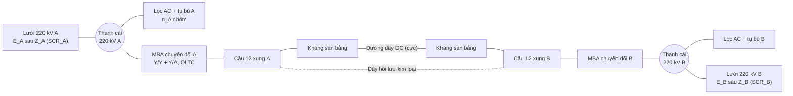
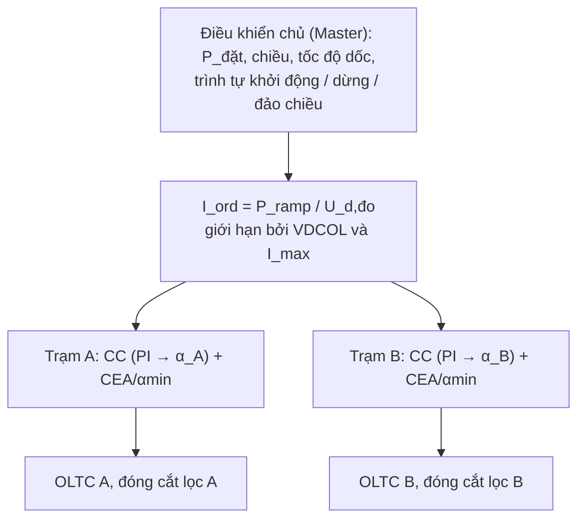

# Mô phỏng vận hành liên kết HVDC LCC A ↔ B (lưới 220 kV)

## 0. Cách dùng tài liệu này với Claude Code

Mở repo VnEMT trong VS Code, khung Claude Code, gõ:

```text
Đọc docs/design/SPEC-mo-phong-van-hanh-LCC.md và triển khai đúng theo đặc tả.
Dùng hvdc-control-engineer cho mô hình và điều khiển, lcc-modeler để kiểm công thức,
validation-engineer chạy các kiểm thử mục 9. Trình kế hoạch trước khi viết mã.
```

Quy tắc trong `CLAUDE.md` vẫn áp dụng: công thức có nguồn, ký hiệu góc theo IEC 60633, không hạ tiêu chí kiểm thử.

---

## 1. Mục tiêu

Xây dựng **trang mô phỏng vận hành tương tác** (HTML + CSS + JavaScript thuần) cho một liên kết HVDC LCC điểm–điểm nối **trạm biến áp A** và **trạm biến áp B**, cả hai nằm trong lưới truyền tải **220 kV**. Người dùng đóng vai điều độ viên/trưởng ca trạm:

- điều chỉnh công suất truyền tải;
- **đảo chiều công suất** A → B ↔ B → A;
- khởi động, dừng liên kết;
- quan sát đáp ứng khi lưới 220 kV sụt áp, đường dây DC sự cố, mất nhóm lọc.

Mô hình dùng **đúng các phương trình của bộ chuyển đổi LCC** (giáo trình *Điện tử công suất ứng dụng trong HVDC*, Chương 6–9; Kimbark; Arrillaga; Kundur ch.10), ở mức **giá trị trung bình** (không mô phỏng dạng sóng từng van).

### Ngoài phạm vi

- Dạng sóng từng van, sóng hài chi tiết (đã có ở lõi EMT Python và trang mô phỏng góc kích).
- VSC (để phiên bản sau).
- Tính toán ngưỡng tiêu chí lưới (theo quyết định đã chốt: người dùng tự đặt).

---

## 2. Hệ thống mô phỏng



### 2.1 Thông số mặc định (tất cả chỉnh được trong trang)

Người dùng chưa cung cấp số liệu dự án, nên dùng bộ mặc định dưới đây. Mọi thông số đặt trong một đối tượng `PARAMS` duy nhất ở đầu mã và có ô chỉnh trong tab "Thông số".

| Nhóm | Thông số | Mặc định | Ghi chú |
| --- | --- | --- | --- |
| Cấu hình | Kiểu | Đơn cực 12 xung, hồi lưu kim loại | Tham số `config` để mở rộng lưỡng cực sau |
| Định mức | P_dn | 400 MW | |
| | U_dn (tại trạm nghịch lưu) | 400 kV | |
| | I_dn | 1,0 kA | = P_dn / U_dn |
| Lưới AC | U_n | 220 kV, 50 Hz | Cả A và B |
| | SCR_A, SCR_B | 3,0 ; 3,0 | S_k = SCR·P_dn |
| | Góc tổng trở lưới | 85° | |
| Đường dây DC | Chiều dài | 300 km | |
| | R tổng mạch vòng (cực + hồi lưu) | 6 Ω | ≈ 0,01 Ω/km/dây |
| | L tổng (đường dây + 2 kháng san bằng) | 1,0 H | |
| Bộ chuyển đổi | dx (sụt áp cảm kháng tương đối) | 0,08 | Xác định Xc |
| | α định mức (chỉnh lưu) | 15° | |
| | γ định mức (nghịch lưu) | 17° | |
| | α_min, α_max | 5°, 150° | |
| | γ_min (giới hạn điều khiển) | 15° | |
| | γ_crit (ngưỡng sự cố chuyển mạch) | 7° | ≈ thời gian phục hồi t_q của thyristor |
| | Biên dòng ΔId | 0,1 pu | |
| OLTC | Dải nấc | −10 … +16 bước | |
| | Bước | 1,25 %/nấc | |
| | Thời gian chuyển một nấc | 5 s | |
| | Dải α mục tiêu (chỉnh lưu) | 12,5° – 17,5° | |
| | Dải γ mục tiêu (nghịch lưu) | 16° – 19° | |
| Lọc AC | Số nhóm mỗi trạm | 4 | |
| | Q mỗi nhóm (tại 220 kV) | 60 Mvar | Q_loc = Q_nhom·(U/U_n)² |
| | Nhóm tối thiểu khi đang chạy | 1 | Yêu cầu lọc sóng hài tối thiểu |
| Vận hành | P_min | 0,1 pu | Không vận hành dưới mức này khi deblock |
| | Tốc độ dốc mặc định | 100 MW/phút | Chỉnh 10–1000 MW/phút |
| VDCOL | (U_d,low; I_low) – (U_d,high; I_high) | (0,3; 0,3) – (0,7; 1,0) pu | Hằng số thời gian giảm 10 ms, tăng 40 ms |

### 2.2 Tính thông số dẫn xuất khi khởi tạo

Không gõ cứng; hàm `deriveParams()` tính và in ra tab "Thông số":

1. Trạm nghịch lưu (mỗi cầu 6 xung): U_d,i/2 = Ud0_i·(cos γ_n − dx) → Ud0_i.
2. Trạm chỉnh lưu: U_d,r = U_dn + R·I_dn; mỗi cầu: U_d,r/2 = Ud0_r·(cos α_n − dx) → Ud0_r.
3. Xc = dx·Ud0·π/(3·I_dn) (lấy theo Ud0 của trạm tương ứng).
4. Điện áp dây phía van định mức: U_v = Ud0 / (3√2/π) = Ud0 / 1,3505.
5. Tỷ số MBA định mức: k = U_v / 220 kV (tại nấc 0).

Kiểm tra số học (dùng làm kiểm thử T-01): với mặc định, Ud0 mỗi cầu ≈ 229 kV (chỉnh lưu) và ≈ 228 kV (nghịch lưu), Xc ≈ 19 Ω, U_v ≈ 170 kV.

---

## 3. Mô hình toán

Ký hiệu theo IEC 60633. Mỗi trạm k ∈ {A, B} có **một** góc kích α_k ∈ [α_min, α_max]; trạm nào có α < 90° là chỉnh lưu, α > 90° là nghịch lưu. Không gắn cố định vai trò cho trạm — điều này cho phép đảo chiều công suất tự nhiên.

### 3.1 Điện áp một chiều của bộ chuyển đổi (12 xung = 2 cầu 6 xung)

```text
Ud0_k = (3√2/π) · U_v,k                    U_v,k = k_n · (1 + tap_k·step) · U_bus,k
V_k   = 2 · [ Ud0_k · cos α_k − (3/π) · Xc · Id ]
```

V_k là sức điện động của bộ chuyển đổi k theo chiều dòng điện. Với α_k > 90°, V_k âm (nghịch lưu).

### 3.2 Trùng dẫn và góc tắt

```text
cos(α_k + μ_k) = cos α_k − √2 · Xc · Id / U_v,k
β_k = 180° − α_k ,   γ_k = β_k − μ_k        (chỉ có nghĩa khi α_k > 90°)
```

Nếu vế phải < −1 thì trùng dẫn không hoàn tất → **sự cố chuyển mạch** (mục 3.6).

### 3.3 Mạch một chiều

Dòng Id chỉ chạy một chiều (Id ≥ 0). Mạch vòng gồm hai bộ chuyển đổi nối tiếp qua đường dây:

```text
L · dId/dt = V_A + V_B − R · Id ,        Id ≥ 0 (kẹp tại 0, van khóa)
```

**Điện áp đầu cực hiển thị** (điện áp cực so với dây hồi lưu, đo tại mỗi trạm, cùng một chiều quy chiếu cho cả hai trạm):

```text
U_d,A = V_A − (R/2)·Id          U_d,B = −V_B + (R/2)·Id
```

Khi A chỉnh lưu (V_A > 0, V_B < 0): U_d,A ≈ U_d,B > 0, chênh nhau R·Id. Khi đảo chiều (V_A < 0, V_B > 0): cả hai **âm**, trong khi **Id vẫn dương**. Giao diện phải thể hiện rõ: *dòng không đổi chiều, điện áp đổi cực tính*.

### 3.4 Công suất

```text
P_k = V_k · Id                       (P_k > 0: trạm k lấy công suất từ lưới AC đưa vào DC)
cos φ_k ≈ [cos α_k + cos(α_k + μ_k)] / 2       (lấy trị tuyệt đối cho nghịch lưu)
Q_conv,k = |P_k| · tan φ_k            (luôn tiêu thụ, ở cả chỉnh lưu và nghịch lưu)
Q_filt,k = n_k · Q_nhom · (U_bus,k / U_n)²
Q_net,k  = Q_conv,k − Q_filt,k        (> 0: trạm hút Q từ lưới)
Tổn hao đường dây = R · Id² ;  P_A + P_B = R·Id² (kiểm tra cân bằng, bỏ qua tổn hao trạm)
```

Công thức Q dùng xấp xỉ cos φ của tài liệu [giáo trình Chương 8.3]; ghi rõ trong mã là xấp xỉ.

### 3.5 Lưới 220 kV tại mỗi trạm (giải đại số mỗi bước)

Lưới là nguồn E_k = 1,0 pu sau tổng trở Z_k = U_n²/S_k ∠85°. Thanh cái có trao đổi P_ac,k = P_k (lấy từ lưới khi chỉnh lưu, bơm vào lưới khi nghịch lưu) và Q_net,k. Giải điện áp thanh cái U_bus,k bằng phương trình truyền tải hai nút (lặp Newton hoặc lặp điểm cố định, tối đa 20 vòng, sai số 1e-6 pu):

```text
S_bus = P_ac + j·Q_net   (chiều: từ thanh cái vào trạm chuyển đổi)
U_bus = E − Z · conj(S_bus / U_bus)
```

Sụt áp lưới (sự cố, mục 6) mô phỏng bằng cách giảm E_k theo kịch bản. Đây là cơ chế tạo **tương tác lưới yếu**: SCR nhỏ → U_bus nhạy với P, Q.

### 3.6 Sự cố chuyển mạch

Tại trạm nghịch lưu, nếu γ_k < γ_crit hoặc mục 3.2 không có nghiệm: đặt cờ CF, trong 10 ms coi V_k = 0 (ngắn mạch qua cầu), ghi sự kiện, tăng bộ đếm CF. Sau đó trở lại tính bình thường.

### 3.7 Tích phân

- Bước điện: Δt = 100 µs, Euler ẩn cho phương trình Id (ổn định với L/R lớn).
- Bước điều khiển: 1 ms (PI, VDCOL, logic).
- Bước điều khiển chậm: 1 s (OLTC, đóng cắt lọc, tốc độ dốc).
- Vòng mô phỏng chạy trong `requestAnimationFrame`, tích phân nhiều bước mỗi khung; có hệ số tốc độ ×1, ×5, ×20, ×100 và nút tạm dừng. Thời gian mô phỏng hiển thị riêng với thời gian thực.

---

## 4. Hệ thống điều khiển

### 4.1 Phân cấp



### 4.2 Điều khiển mỗi trạm (đối xứng, vai trò theo biên dòng)

Mỗi trạm k chạy cùng một thuật toán, lấy **góc nhỏ nhất của hai bộ điều khiển** (cách làm phổ biến, đặc tính Ud–Id dạng kinh điển):

```text
I_ord,k = I_ord              nếu k là trạm chỉnh lưu được chỉ định
I_ord,k = I_ord − ΔId        nếu k là trạm nghịch lưu được chỉ định    (biên dòng)

α_CC,k  = PI_k( I_ord,k − Id )          (sai số dương → giảm α)
α_CEA,k = 180° − β_CEA,k
β_CEA,k = arccos( cos γ_ref − √2·Xc·Id / U_v,k )        (CEA dự đoán)

α_k = clamp( min(α_CC,k , α_CEA,k) , α_min , α_max )     ← nghịch lưu: CEA chiếm quyền khi CC bão hòa
```

Kết quả mong đợi:

- **Bình thường:** trạm chỉnh lưu giữ Id = I_ord bằng α; trạm nghịch lưu chạy CEA giữ γ = γ_ref.
- **Khi U_bus chỉnh lưu giảm mạnh:** chỉnh lưu chạm α_min; dòng giảm xuống I_ord − ΔId; CC của nghịch lưu nhận quyền điều khiển dòng (hoán đổi vai trò). Phải thấy được trên đồ thị Ud–Id.
- PI có chống bão hòa tích phân; tham số mặc định Kp = 1,5 rad/pu, Ki = 80 rad/(pu·s) (chỉnh được).

### 4.3 VDCOL

```text
I_lim(U) = I_low                                  nếu U ≤ U_low
         = I_low + (U − U_low)/(U_high − U_low)·(I_high − I_low)   nếu U_low < U < U_high
         = I_high                                 nếu U ≥ U_high
I_ord,thực = min(I_ord, I_lim(U_d,lọc))    với U_d,lọc lọc bậc 1 (τ giảm 10 ms, τ tăng 40 ms)
```

### 4.4 OLTC (bước điều khiển chậm)

- Trạm chỉnh lưu: nếu α > 17,5° kéo dài > 5 s → tăng U_v một nấc; nếu α < 12,5° → giảm một nấc.
- Trạm nghịch lưu: tương tự với dải γ (hoặc giữ U_d định mức — tùy chọn trong tab Thông số).
- Có trễ, có chặn khi đang trong trình tự đảo chiều/khởi động.

### 4.5 Đóng cắt lọc (bước điều khiển chậm)

- Đóng thêm nhóm khi Q_net > +0,5·Q_nhom kéo dài > 2 s; cắt nhóm khi Q_net < −0,5·Q_nhom kéo dài > 2 s.
- Không cắt dưới số nhóm tối thiểu khi deblock; chặn đóng cắt lặp (thời gian tối thiểu giữa hai lần thao tác cùng trạm: 10 s).
- Trước khi deblock: đóng số nhóm tối thiểu ở cả hai trạm.

### 4.6 Điều khiển công suất và tốc độ dốc

```text
P_ramp tiến về P_đặt với tốc độ dốc (MW/phút)
I_ord = clamp( P_ramp / max(|U_d,đo|, 0,3 pu·U_dn) , I_min , 1,1 pu )
```

Chế độ chọn được: **điều khiển công suất** (mặc định) hoặc **điều khiển dòng** (người dùng đặt I_ord trực tiếp).

---

## 5. Trình tự vận hành

### 5.1 Khởi động (Deblock)

1. Kiểm tra: không có sự cố, đủ số nhóm lọc tối thiểu ở hai trạm.
2. Đặt α_chỉnh lưu = α_nghịch lưu = 90° (U_d ≈ 0), deblock nghịch lưu trước, sau đó chỉnh lưu (cách nhau 20 ms).
3. Nghịch lưu chuyển dần sang CEA; chỉnh lưu tăng dòng tới I_min.
4. Tăng P theo tốc độ dốc tới P_đặt.

### 5.2 Dừng (Block)

Giảm P theo tốc độ dốc về P_min → đưa chỉnh lưu lên α ≈ 120° (cưỡng bức nghịch lưu) để xả năng lượng đường dây, Id → 0 → khóa xung cả hai trạm → cắt lọc theo trình tự.

### 5.3 Đảo chiều công suất (bài toán trọng tâm)

Với LCC, **dòng Id không đổi chiều**; đảo chiều công suất bằng **đảo cực tính điện áp DC** thông qua hoán đổi vai trò hai trạm (chuyển biên dòng sang trạm kia). Trình tự tự động khi người dùng bấm "Đảo chiều":

| Bước | Hành động | Điều kiện chuyển bước |
| --- | --- | --- |
| R1 | Giảm P theo tốc độ dốc về P_min | P ≤ P_min |
| R2 | Chặn OLTC và đóng cắt lọc; ghi trạng thái | — |
| R3 | **Chuyển biên dòng**: trạm đang chỉnh lưu nhận I_ord − ΔId, trạm đang nghịch lưu nhận I_ord | Tức thời |
| R4 | Hai bộ CC cùng tác động: trạm cũ chỉnh lưu tăng α qua 90°, trạm cũ nghịch lưu giảm α qua 90°; U_d đi qua 0 và đổi dấu, Id duy trì ≈ I_min | U_d đổi dấu và \|U_d\| ≥ 0,8·U_dn |
| R5 | Trạm mới nghịch lưu chuyển sang CEA | γ ổn định trong ±1° |
| R6 | Bỏ chặn OLTC, lọc; tăng P theo chiều mới tới P_đặt | P = P_đặt |

Yêu cầu hiển thị trong suốt quá trình: mũi tên chiều công suất, cực tính U_d (đổi màu/ký hiệu ±), α hai trạm đi qua 90°, Id không đổi chiều, nhãn vai trò "CHỈNH LƯU / NGHỊCH LƯU" của mỗi trạm đổi chỗ. Thời gian toàn trình tự hiển thị trong nhật ký.

Có tùy chọn **đảo chiều nhanh** (bỏ R1, đảo khi đang mang tải) để minh họa vì sao thực tế phải giảm công suất trước: ghi cảnh báo nếu quá điện áp hoặc CF xảy ra.

### 5.4 Thao tác tay

- Bật/tắt từng nhóm lọc, tăng/giảm nấc tay (khi OLTC ở chế độ tay).
- Chuyển chế độ: Tự động / Tay cho OLTC và lọc.
- Đặt P, chiều, tốc độ dốc; đặt I_ord ở chế độ điều khiển dòng.

---

## 6. Sự kiện và sự cố có thể chèn

| Mã | Sự kiện | Tham số | Hiện tượng phải thấy |
| --- | --- | --- | --- |
| E1 | Sụt áp lưới 220 kV tại A hoặc B | Độ sâu 0–80 %, thời gian 50–500 ms | Ở phía nghịch lưu: γ giảm, có thể CF; VDCOL giảm dòng; phục hồi |
| E2 | Sụt áp phía chỉnh lưu sâu | — | Chỉnh lưu chạm α_min, nghịch lưu nhận CC (hoán đổi vai trò) |
| E3 | Sự cố đường dây DC chạm đất | Thời gian khử ion 200 ms | Cưỡng bức nghịch lưu (α_chỉnh lưu ≈ 120–150°), Id → 0, chờ khử ion, khởi động lại (tối đa 2 lần) |
| E4 | Mất một nhóm lọc | Trạm, nhóm | U_bus giảm, Q_net tăng, logic đóng nhóm dự phòng |
| E5 | Thay đổi SCR | SCR mới | Thử lưới yếu (SCR 1,5–2) |
| E6 | Bước P_đặt | ΔP | Đáp ứng điều khiển công suất |

Logic phục hồi sự cố DC (E3) theo giáo trình Chương 9.8 và SPEC-v0.1 F4-07.

---

## 7. Giao diện

### 7.1 Bố cục

```text
┌──────────────────────── Thanh trạng thái: t_mô phỏng | Tốc độ ×N | Trạng thái liên kết | Chiều P ────────────────┐
│ [Sơ đồ một sợi động SVG: lưới A – lọc – MBA – cầu – đường dây – cầu – MBA – lọc – lưới B]                         │
├──────────────── Bảng điều khiển ───────────────┬──────────── Đồng hồ hai trạm (A | B) ──────────────────────────┤
│ Deblock / Block / Đảo chiều / Dừng khẩn cấp     │ U_bus, P, Q_conv, Q_filt, nhóm lọc, nấc, α, μ, γ, vai trò, chế độ│
│ P_đặt, chiều, tốc độ dốc, chế độ P/I            │ Ud, Id, tổn hao đường dây, CF đếm                                │
│ Chèn sự cố E1–E6                                │                                                                  │
├──────────────── Đồ thị theo thời gian (cửa sổ trượt 10/60/600 s) ──────────────┬─── Đặc tính Ud–Id + điểm làm việc ─┤
│ P_A, P_B | Ud, Id | α_A, α_B, γ | U_bus A, B | Q_net A, B                        │                                     │
├──────────────── Nhật ký sự kiện kiểu SCADA (thời gian mô phỏng, trạm, sự kiện) — tải xuống CSV ─────────────────────┤
└──────────────── Tab: Vận hành | Thông số | Công thức | Hướng dẫn ─────────────────────────────────────────────────────┘
```

### 7.2 Sơ đồ một sợi

- Vẽ SVG nhúng; mũi tên công suất động (độ dày theo |P|, chiều theo dấu).
- Biểu tượng cầu thyristor đổi nhãn "Chỉnh lưu"/"Nghịch lưu"; màu theo trạng thái (deblock/block/sự cố).
- Đường dây DC hiển thị cực tính "+" / "−" theo dấu U_d; mũi tên dòng Id luôn cùng một chiều.
- Nhóm lọc là ô bấm được (đóng/cắt tay), hiển thị trạng thái.

### 7.3 Đồ thị

- **Không dùng thư viện ngoài** (yêu cầu chạy ngoại tuyến): vẽ bằng Canvas 2D, có lưới, nhãn trục, chú giải, bộ đệm vòng cho dữ liệu.
- Đồ thị Ud–Id vẽ: đường α_min chỉnh lưu, đường CC chỉnh lưu, đường CEA nghịch lưu, đường CC nghịch lưu (I_ord − ΔId), VDCOL; điểm làm việc hiện tại; cập nhật khi đảo chiều (vẽ ở góc phần tư tương ứng cực tính).

### 7.4 Tab "Công thức"

Liệt kê đúng các phương trình mục 3–4 kèm giá trị tức thời thay số (ví dụ `V_A = 2·[229,1·cos 15,2° − 0,955·19,2·1,00] = …`), để người học đối chiếu.

### 7.5 Yêu cầu chung

- Tiếng Việt toàn bộ; số thập phân dùng dấu phẩy.
- Light/Dark mode theo `prefers-color-scheme` + nút chuyển; màu tách bằng biến CSS.
- Responsive tới 400 px (bảng điều khiển xếp dọc).
- Bàn phím: phím tắt Space = tạm dừng; có focus rõ ràng.
- Lưu/khôi phục cấu hình và kịch bản ra file JSON (tải xuống/tải lên).

---

## 8. Kiến trúc mã và vị trí file

| Mục | Quy định |
| --- | --- |
| Vị trí | `web/hvdc-ops/index.html` — **một file**, CSS và JS nhúng, không tải tài nguyên ngoài |
| Liên kết | Thêm đường dẫn từ `web/index.html` và mục "Chạy thử" của `README.md`; cập nhật `web/build_site.py` để file được xuất bản lên GitHub Pages |
| Cấu trúc JS | Các khối tách rõ trong một file: `PARAMS` + `deriveParams()`; `model` (mục 3, hàm thuần, không đụng DOM); `control` (mục 4); `sequencer` (mục 5, máy trạng thái); `events` (mục 6); `ui` (mục 7) |
| Hàm thuần | `converterVoltage`, `overlapAngle`, `gammaFromBeta`, `reactivePower`, `solveAcBus`, `vdcol`, `ceaBeta` — để kiểm thử độc lập |
| Kiểm thử | `web/hvdc-ops/tests.html` (hoặc chạy bằng Node: `node web/hvdc-ops/tests.mjs`) gọi các hàm thuần; tích hợp vào `pytest` qua lệnh Node nếu môi trường có Node, nếu không thì đánh dấu bỏ qua |
| Truy xuất | Ghi mã yêu cầu (WEB-OPS-xx, F1-L01, F3-01, F3-04, F4-07, F5-03, F5-05) trong comment; cập nhật `docs/traceability.md` |
| Phiên bản | Hiển thị phiên bản trang và ngày dựng ở chân trang |

---

## 9. Kiểm thử nghiệm thu

| Mã | Kiểm thử | Tiêu chí |
| --- | --- | --- |
| T-01 | `deriveParams()` với mặc định | Ud0, Xc, U_v khớp tính tay mục 2.2 (sai số < 0,5 %) |
| T-02 | Xác lập định mức A → B | Id = 1,00 ± 0,01 kA; U_d,B = 400 ± 2 kV; α_A ∈ [12,5°; 17,5°] sau OLTC; γ_B = 17 ± 0,5° |
| T-03 | Cân bằng công suất | \|P_A + P_B − R·Id²\| < 0,1 % P_dn ở xác lập |
| T-04 | Công thức μ, γ | Với Id, U_v, α cho trước, μ và γ khớp công thức 3.2 sai số < 0,1° |
| T-05 | Q tiêu thụ | Ở định mức, Q_conv/P nằm trong 0,45–0,60 (kiểm tra tính hợp lý của xấp xỉ, không phải ngưỡng thiết kế) |
| T-06 | Điều chỉnh công suất | Bước P_đặt 0,5 → 1,0 pu: P đi theo tốc độ dốc, sai số xác lập < 1 % |
| T-07 | Đảo chiều | Sau trình tự R1–R6: P_B > 0 (B xuất khẩu), U_d đổi dấu, **Id luôn ≥ 0 suốt quá trình**, không CF, P đạt P_đặt theo chiều mới |
| T-08 | Hoán đổi vai trò khi sụt áp chỉnh lưu (E2) | Id xác lập ≈ I_ord − ΔId (±0,02 pu); trạm nghịch lưu ở chế độ CC |
| T-09 | Sụt áp nghịch lưu 15 % / 100 ms (E1), SCR = 3 | Ghi nhận số CF (giá trị được ghi, không áp ngưỡng); hệ thống phục hồi ≥ 90 % P trong thời gian được ghi lại |
| T-10 | Sự cố DC (E3) | Id → 0 trong < 50 ms sau cưỡng bức nghịch lưu; khởi động lại thành công sau khử ion |
| T-11 | Đóng cắt lọc | Không có hai thao tác cùng trạm cách nhau < 10 s; không cắt dưới số nhóm tối thiểu |
| T-12 | Giao diện | Chuyển tab, đổi Light/Dark, hiển thị ở 400 px không tràn ngang; chạy ngoại tuyến (không có request mạng) |

Kiểm thử T-09 không áp ngưỡng đạt/không đạt cho số CF và thời gian phục hồi vì tiêu chí lưới do người dùng tự đặt (quyết định 29/10/2026); trang chỉ báo cáo giá trị.

---

## 10. Giới hạn của mô hình (phải ghi trong tab "Hướng dẫn")

- Mô hình giá trị trung bình: không có dạng sóng van, sóng hài, dao động tần số cao; sự cố chuyển mạch được mô hình hóa giản lược.
- Lưới AC là nguồn Thevenin cố định tần số; không mô phỏng máy phát, dao động góc, tần số lưới.
- Q theo xấp xỉ cos φ; tổn hao trạm bỏ qua.
- Thông số mặc định là giả định giáo khoa, không đại diện cho dự án cụ thể. Số liệu thật đặt trong `private/` và nạp qua file JSON.

## 11. Tài liệu tham khảo

- Giáo trình *Điện tử công suất ứng dụng trong HVDC* (bộ tài liệu dự án), Chương 6–9.
- E. W. Kimbark, *Direct Current Transmission, Vol. 1*, Wiley, 1971.
- J. Arrillaga, *High Voltage Direct Current Transmission*, 2nd ed., IET, 1998.
- P. Kundur, *Power System Stability and Control*, McGraw-Hill, 1994, ch. 10.
- IEC 60633:2019, *HVDC transmission – Vocabulary*.
- IEC TR 60919-1:2020, *Performance of HVDC systems with LCC – Part 1: Steady-state conditions*.
- `docs/SPEC-v0.1.md` (F1-L, F3, F4, F5), `docs/so-tay-HVDC.md` Phần 1.
