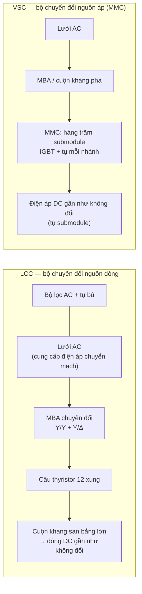
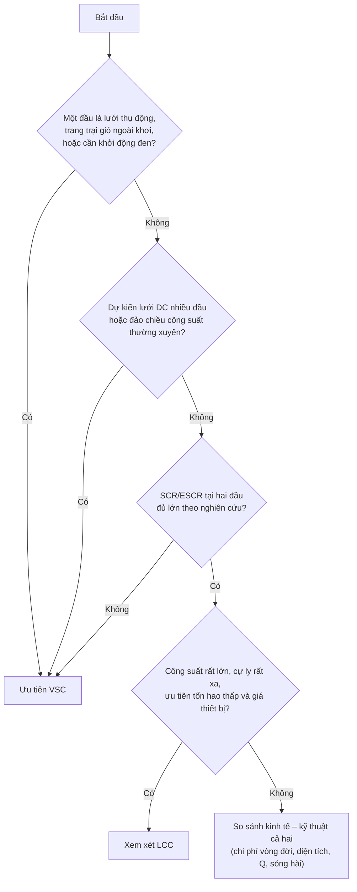

# Sổ tay tự học HVDC

Sổ tay dành cho người tự học về truyền tải điện một chiều cao áp (HVDC). Nội dung chia ba phần:

| Phần | Chủ đề |
| --- | --- |
| [1](#phần-1--lcc-và-vsc) | LCC và VSC: nguyên lý, linh kiện, điều khiển P/Q, sóng hài, lưới yếu, ứng dụng, khuyến cáo lựa chọn |
| [2](#phần-2--vận-hành-và-bảo-trì) | Vận hành và bảo trì: độ phức tạp, hạng mục bảo dưỡng, sự cố thường gặp, nhân lực, phụ tùng, chi phí vòng đời |
| [3](#phần-3--lựa-chọn-thiết-bị-trạm-hvdc) | Lựa chọn thiết bị trạm: MBA chuyển đổi, đóng cắt AC/DC, van, cuộn kháng, lọc, làm mát, điều khiển – bảo vệ; tiêu chuẩn IEC |

**Quy ước trích dẫn.** Số trong ngoặc vuông [n] trỏ tới [Tài liệu tham khảo](#tài-liệu-tham-khảo). Phiên bản tiêu chuẩn được tra cứu ngày 30/10/2026; chỗ nào chưa xác minh được ghi rõ "chưa xác minh". Nhận định của nhà sản xuất được ghi là **nhận định của nhà sản xuất**, không phải kết luận độc lập.

**Ba loại yếu tố** được phân biệt xuyên suốt sổ tay:

| Ký hiệu | Ý nghĩa |
| --- | --- |
| 🔷 **Bản chất công nghệ** | Đúng với mọi dự án dùng công nghệ đó, do vật lý của linh kiện/sơ đồ quyết định |
| 🔶 **Phụ thuộc thiết kế / nhà sản xuất** | Thay đổi theo cấu hình, thế hệ thiết bị, nhà cung cấp |
| 🟢 **Phụ thuộc dự án / vận hành** | Thay đổi theo lưới, khí hậu, chế độ vận hành, tổ chức bảo trì |

---

## Phần 1 — LCC và VSC

### Mục tiêu học tập

Sau phần này, người học có thể:

1. Giải thích vì sao LCC cần lưới AC để chuyển mạch còn VSC thì không.
2. So sánh thyristor và IGBT về cơ chế điều khiển và hệ quả với thiết kế trạm.
3. Giải thích nguồn gốc nhu cầu công suất phản kháng và sóng hài của LCC.
4. Nêu điều kiện lưới yếu và khả năng khởi động đen của từng công nghệ.
5. Đưa ra khuyến cáo lựa chọn sơ bộ theo tình huống, và biết điểm nào phải nghiên cứu riêng cho dự án.

### 1.1 Hai cách chuyển đổi AC ↔ DC

**LCC (Line-Commutated Converter).** 🔷 Van thyristor chỉ được *kích mở* bằng xung cổng; thyristor tự tắt khi dòng qua nó về 0 nhờ điện áp lưới AC đổi chiều. Do đó lưới AC phải đủ "cứng" để làm chuyển mạch. Điều khiển chủ yếu bằng góc kích α (chỉnh lưu) và góc tắt γ (nghịch lưu). Dòng DC giữ một chiều; muốn đảo chiều công suất phải **đảo cực tính điện áp DC** [3], [14].

**VSC (Voltage-Sourced Converter).** 🔷 Van IGBT (hoặc linh kiện tắt được khác) *mở và tắt theo lệnh*. Bộ chuyển đổi tự tạo ra điện áp AC với biên độ và góc pha mong muốn, nên điều khiển độc lập được công suất tác dụng P và công suất phản kháng Q. Điện áp DC giữ một cực tính; đảo chiều công suất bằng **đảo chiều dòng điện** [2], [15]. Cấu trúc phổ biến hiện nay là bộ chuyển đổi đa mức module (MMC).

### 1.2 Thyristor và IGBT

| Tiêu chí | Thyristor (LCC) | IGBT (VSC/MMC) | Loại yếu tố |
| --- | --- | --- | --- |
| Điều khiển | Chỉ mở được bằng cổng; tắt nhờ mạch ngoài | Mở và tắt theo điện áp cổng | 🔷 |
| Tần số đóng cắt | Tần số lưới (50/60 Hz) | Cao hơn; trong MMC mỗi IGBT đóng cắt tần số thấp nhờ số mức lớn | 🔷 / 🔶 |
| Sụt áp khi dẫn, tổn hao | Thấp | Cao hơn ở cùng định mức | 🔷 (giá trị cụ thể 🔶) |
| Định mức đơn chiếc | Rất cao (tấm silic 5–6 inch, cấp điện áp vài kV) | Thấp hơn; ghép nối tiếp/module | 🔶 |
| Trạng thái khi hỏng | Vỏ ép: thường ngắn mạch → van có cấp dự phòng nối tiếp | Module: có thể hở mạch → cần bypass; press-pack: ngắn mạch | 🔶 |
| Cấu trúc van | Chuỗi nhiều cấp thyristor nối tiếp + snubber RC + cuộn kháng bão hòa | Nhiều submodule nối tiếp, mỗi SM có tụ, bypass, điện tử điều khiển | 🔷 |

Giải thích chi tiết cấu tạo linh kiện: xem giáo trình *Điện tử công suất ứng dụng trong HVDC*, Chương 4–5.

### 1.3 Điều khiển công suất tác dụng và phản kháng

| Khả năng | LCC | VSC |
| --- | --- | --- |
| Điều khiển P | Có, nhanh, qua dòng đặt (CC) ở chỉnh lưu, góc tắt (CEA) ở nghịch lưu | Có, nhanh, qua vòng dòng trục d |
| Điều khiển Q | Không độc lập: bộ chuyển đổi **luôn tiêu thụ** Q, lượng tiêu thụ thay đổi theo P | Độc lập với P trong giới hạn dòng: phát hoặc nhận Q |
| Đảo chiều công suất | Đảo cực tính điện áp DC, cần trình tự phối hợp hai trạm | Đảo chiều dòng, điện áp DC giữ nguyên |
| Nhiều trạm trên một lưới DC | Khó (do phải đảo cực tính); có dự án nhiều đầu nhưng hạn chế | Thuận lợi; là công nghệ cho lưới DC nhiều đầu |

🔷 **Vì sao LCC tiêu thụ Q?** Dòng AC của cầu trễ pha sau điện áp một góc xấp xỉ α (và γ ở nghịch lưu) cộng thêm ảnh hưởng của góc trùng dẫn. Một trạm LCC tiêu thụ khoảng **50–60 % công suất tác dụng** dưới dạng công suất phản kháng, phải bù bằng bộ lọc và tụ (nhận định của Siemens [17]); tài liệu của ABB nêu nhu cầu bù khoảng 50 % [16]. Con số cụ thể 🟢 phụ thuộc góc vận hành, điện kháng MBA và dải nấc của từng dự án.

### 1.4 Sóng hài

| | LCC | VSC (MMC) |
| --- | --- | --- |
| Nguồn gốc | Dòng AC dạng khối chữ nhật: sóng hài đặc trưng bậc 12k ± 1 phía AC với cầu 12 xung, bậc 12k phía DC [3] | Điện áp ra nhiều bậc gần hình sin; sóng hài thấp hơn |
| Bộ lọc | Bắt buộc lọc AC (thường kép điều chỉnh 11/13, 24/36, thông cao) và thường có lọc DC với đường dây trên không | Nhà sản xuất nêu MMC không cần hoặc chỉ cần ít bộ lọc [16], [17] |
| Lưu ý | Lọc AC đồng thời là nguồn bù Q; đóng cắt nhóm lọc theo tải | 🟢 Vẫn phải đánh giá cộng hưởng, tương tác điều khiển với lưới ở dải tần cao; có dự án vẫn cần lọc |

Hướng dẫn thiết kế lọc AC cho HVDC: IEC TR 62001 (Phần 1:2021) [9].

### 1.5 Lưới yếu và khởi động đen

- 🔷 **LCC** cần lưới AC đủ mạnh. Tài liệu ABB nêu yêu cầu công suất ngắn mạch lớn hơn khoảng 2 lần công suất DC (khoảng 1,3 lần với bộ chuyển đổi chuyển mạch bằng tụ – CCC) [16]. Lưới yếu làm tăng nguy cơ **sự cố chuyển mạch** khi điện áp AC phía nghịch lưu sụt; trong thời gian đó công suất truyền gián đoạn ngắn [3], [17].
- 🔷 **VSC** không cần lưới để chuyển mạch, có thể hỗ trợ điện áp động, cấp điện cho lưới thụ động và **khởi động đen** [16], [17]. 🟢 Mức độ thực tế (ví dụ khả năng tạo lưới – grid-forming) phụ thuộc điều khiển được đặt hàng và nghiên cứu hệ thống.
- 🔶 Mức SCR/ESCR tối thiểu cho từng dự án phải xác định bằng nghiên cứu, không lấy số chung.

### 1.6 Ví dụ ứng dụng thực tế

| Ứng dụng | Công nghệ điển hình | Ví dụ (đã đề cập trong giáo trình và tài liệu nhà sản xuất) |
| --- | --- | --- |
| Truyền tải công suất rất lớn, cự ly rất xa, lưới hai đầu mạnh | LCC (UHVDC ±800 kV, ±1100 kV) | Changji–Guquan ±1100 kV (Trung Quốc); Belo Monte ±800 kV (Brazil); North-East–Agra ±800 kV (Ấn Độ) |
| Kết nối điện gió ngoài khơi | VSC (MMC) | Các giàn chuyển đổi DolWin, BorWin (Biển Bắc, Đức) |
| Liên kết xuyên biển giữa các quốc gia | VSC (các dự án mới) | NordLink (Na Uy – Đức), North Sea Link (Na Uy – Anh), Viking Link (Anh – Đan Mạch) |
| Cấp điện vào lưới yếu, khu vực đô thị, lưới DC nhiều đầu | VSC | Pugalur–Thrissur 2000 MW (Ấn Độ, VSC đầu tiên của nước này) |

### 1.7 Khuyến cáo lựa chọn sơ bộ

| Tình huống | Khuyến cáo sơ bộ | Phải nghiên cứu thêm cho dự án |
| --- | --- | --- |
| Truyền tải điểm–điểm công suất rất lớn giữa hai lưới mạnh | LCC thường cạnh tranh | Tổn hao, chi phí lọc và bù, diện tích, rủi ro sự cố chuyển mạch khi lưới nhận yếu đi theo thời gian |
| Điện gió ngoài khơi, đảo, giàn khoan | VSC | Định mức cáp, trọng lượng giàn, FRT, điện trở hãm DC |
| Nối vào lưới yếu hoặc khu đô thị chật | VSC | Diện tích, khả năng hỗ trợ điện áp, tương tác điều khiển với nguồn nghịch lưu lân cận |
| Lưới DC nhiều đầu trong tương lai | VSC | Chiến lược bảo vệ sự cố DC: máy cắt DC, submodule cầu đủ, hoặc cắt phía AC |
| Back-to-back giữa hai lưới không đồng bộ | Cả hai đều dùng được | Mức ngắn mạch hai phía, yêu cầu Q, chi phí |

CIGRE TB 492 (WG B4.46) phân tích khía cạnh kinh tế của VSC so với các công nghệ AC và DC khác [12].

### 1.8 Lưu ý kỹ thuật

- Bảng so sánh chỉ là định hướng. Lựa chọn cuối cùng phải dựa trên nghiên cứu hệ thống: trào lưu, ngắn mạch, ổn định, EMT, sóng hài, độ tin cậy, chi phí vòng đời.
- Số liệu tổn hao, diện tích, chi phí trong tài liệu nhà sản xuất là cho cấu hình cụ thể của họ. Tổn hao trạm phải được xác định theo **IEC 61803:2026** (bản 3, nay bao gồm cả trạm VSC) [8] và, riêng van MMC, **IEC 62751-2** [13].
- 🔶 Ranh giới "LCC rẻ hơn ở công suất lớn" thay đổi theo thời gian do định mức IGBT và giá thiết bị thay đổi; không dùng ngưỡng cố định.

### Tóm tắt Phần 1

- LCC: thyristor, chuyển mạch nhờ lưới, tiêu thụ Q lớn, cần lọc AC, đảo chiều bằng đảo cực tính, mạnh ở công suất lớn và cự ly xa giữa lưới mạnh.
- VSC: IGBT, tự chuyển mạch, điều khiển P và Q độc lập, sóng hài thấp, hỗ trợ lưới yếu, khởi động đen, phù hợp ngoài khơi và lưới DC nhiều đầu.
- Mọi con số về Q, SCR tối thiểu, tổn hao, diện tích đều phụ thuộc dự án hoặc nhà sản xuất.

---

## Phần 2 — Vận hành và bảo trì

### Mục tiêu học tập

1. Nhận diện các hệ thống con của trạm HVDC và hạng mục bảo trì tương ứng.
2. Phân biệt khác biệt bảo trì do bản chất công nghệ với khác biệt do thiết kế, nhà sản xuất và tổ chức vận hành.
3. Biết nguồn dữ liệu độ tin cậy quốc tế và cách đọc chúng.
4. Lập danh mục câu hỏi cần hỏi nhà cung cấp về vận hành – bảo trì trước khi chọn thiết bị.

### 2.1 Nguyên tắc đánh giá

Không có căn cứ công khai đủ mạnh để kết luận chung "LCC dễ bảo trì hơn VSC" hay ngược lại. Mức độ bảo trì của một trạm phụ thuộc mạnh vào thiết kế van, độ dự phòng, hệ thống làm mát, chiến lược bảo trì (theo thời gian hay theo tình trạng), mức độ hỗ trợ của nhà sản xuất và tuổi thiết bị. Sổ tay chỉ so sánh **đặc điểm**, không xếp hạng.

### 2.2 So sánh theo hệ thống con

| Hệ thống con | LCC | VSC (MMC) | Loại yếu tố |
| --- | --- | --- | --- |
| Van | Chuỗi cấp thyristor; kiểm tra cấp thyristor, snubber, điện trở phân áp, mạch kích; có cấp dự phòng | Số lượng submodule lớn (hàng trăm mỗi nhánh); mỗi SM có IGBT, tụ, bypass, bo điều khiển; có SM dự phòng | Cấu trúc 🔷; số lượng, độ dự phòng 🔶 |
| Tụ điện | Tụ trong snubber, lọc AC/DC | Tụ submodule số lượng rất lớn; cùng với tụ lọc (nếu có) | 🔷 |
| Bộ lọc AC và bù | Nhiều nhóm lọc, tụ, kháng, máy cắt đóng cắt nhóm lọc thường xuyên | Ít hoặc không có lọc | 🔷 (số lượng 🔶) |
| MBA chuyển đổi | Chịu ứng suất DC và sóng hài; có OLTC thao tác thường xuyên | Ứng suất DC tùy cấu hình (đơn cực đối xứng hay lưỡng cực); có thể có OLTC | 🔶 |
| Làm mát van | Nước khử ion: độ dẫn điện, lưu lượng, rò rỉ, bộ trao đổi nhiệt | Như LCC; tổn hao nhiệt lớn hơn ở cùng định mức | 🔷 / 🔶 |
| Điều khiển – bảo vệ | Nhiều lớp, dự phòng kép; phần mềm của nhà sản xuất | Như LCC, cộng thêm điều khiển và giám sát từng SM | 🔶 |
| Cuộn kháng san bằng, lọc DC | Có | Cuộn kháng nhánh; lọc DC tùy dự án | 🔶 |

### 2.3 Hạng mục bảo dưỡng điển hình

Danh mục tổng quát; chu kỳ và phương pháp cụ thể theo hướng dẫn của nhà sản xuất và quy định của đơn vị quản lý vận hành.

| Hạng mục | LCC | VSC |
| --- | --- | --- |
| Kiểm tra van khi cắt điện định kỳ | Thử cấp thyristor (khóa, mở, kích bảo vệ), đo snubber, phân áp | Kiểm tra SM theo hướng dẫn nhà sản xuất, đọc nhật ký lỗi SM, thay SM hỏng |
| Theo dõi trong vận hành | Số cấp thyristor hỏng so với số dự phòng (VBE báo) | Số SM bị bypass so với số dự phòng |
| Hệ thống nước làm mát | Độ dẫn điện, lọc, bộ khử ion, bơm, rò rỉ | Như LCC |
| MBA chuyển đổi | Phân tích khí hòa tan (DGA), sứ xuyên, OLTC | Như LCC (OLTC nếu có) |
| Bộ lọc AC, tụ bù | Đo điện dung, phát hiện tụ hỏng, mất cân bằng | Thường ít hơn |
| Điều khiển – bảo vệ | Kiểm tra dự phòng, cập nhật phần mềm có kiểm soát, sao lưu cấu hình | Như LCC |
| Thử nghiệm hệ thống sau sửa chữa lớn | Theo IEC 61975 [7] và chương trình của dự án | Như LCC |

### 2.4 Sự cố thường gặp và dữ liệu độ tin cậy

- **MBA chuyển đổi.** CIGRE TB 859 (khảo sát 2013–2020) cho biết hư hỏng MBA chuyển đổi là **nguyên nhân đóng góp lớn nhất vào điện năng không khả dụng cưỡng bức** của hệ thống HVDC; phần lớn hư hỏng ở hệ thống trên 25 năm tuổi; hệ thống đưa vào vận hành sau 2005 có tỷ lệ hư hỏng rất thấp; báo cáo 2019 và 2021 ghi tỷ lệ hư hỏng dưới 0,006 [19]. Thời gian thay thế dài, nên phụ tùng MBA là yếu tố then chốt về khả dụng.
- **Sự cố chuyển mạch (chỉ LCC).** Do sụt áp lưới AC phía nghịch lưu; gây gián đoạn truyền công suất ngắn, không phải hư hỏng thiết bị, nhưng ảnh hưởng ổn định lưới 🔷.
- **Hỏng cấp thyristor / submodule.** Được thiết kế dự phòng; hệ thống tiếp tục vận hành tới khi số hỏng vượt số dự phòng 🔶.
- **Sự cố hệ thống làm mát, điều khiển – bảo vệ, thiết bị AC phụ trợ:** thường gặp trong thống kê cắt điện cưỡng bức; tỷ trọng cụ thể cần xem báo cáo khảo sát đầy đủ.

**Nguồn dữ liệu độ tin cậy:** CIGRE AG B4.04 thu thập dữ liệu vận hành theo giao thức CIGRE (TB 346, TB 590, nay là **TB 956** mở rộng cho lưới DC, nhiều đầu, đóng cắt DC, điện gió ngoài khơi) [20]. Khảo sát mới nhất bao trùm 2023–2024 (CIGRE B4-11765, 2026), báo cáo khả dụng năng lượng, cắt điện cưỡng bức và có số liệu riêng cho VSC [21]. Đánh giá độ tin cậy, khả dụng: IEC TR 62672-1:2018 (cho LCC) [22].

> Lưu ý: số liệu khảo sát theo hệ thống, gộp nhiều thế hệ thiết bị và nhà sản xuất. Không dùng trực tiếp để so sánh LCC với VSC khi số mẫu VSC còn ít và tuổi thiết bị khác nhau.

### 2.5 Nhân lực, phụ tùng, thời gian khắc phục

| Khía cạnh | Điểm chung | Khác biệt LCC / VSC | Loại yếu tố |
| --- | --- | --- | --- |
| Nhân lực | Kỹ sư điều khiển – bảo vệ, điện tử công suất, thiết bị cao áp, làm mát; đào tạo theo hệ thống cụ thể của nhà sản xuất | LCC: thêm kỹ năng về lọc AC, đóng cắt nhóm lọc. VSC: thêm kỹ năng quản lý số lượng lớn SM và điện tử ở thế cao | 🔶 |
| Phụ tùng | Thyristor/SM, bo điện tử, tụ, sứ xuyên, phụ tùng làm mát, phụ tùng điều khiển; MBA dự phòng là quyết định lớn | VSC: số chủng loại linh kiện có thể ít nhưng số lượng SM lớn; nguồn cung linh kiện điện tử có vòng đời ngắn hơn tuổi thọ trạm | 🔶 |
| Thời gian khắc phục | Thay cấp thyristor/SM: ngắn nếu có dự phòng và phụ tùng tại chỗ; thay MBA: dài (tháng nếu không có máy dự phòng) | Phụ thuộc thiết kế khả năng tiếp cận van và hợp đồng hỗ trợ | 🔶 / 🟢 |
| Lỗi thời phần mềm, phần cứng điều khiển | Cả hai đều phải nâng cấp điều khiển trong vòng đời trạm | — | 🔶 |

### 2.6 Chi phí vòng đời

Chi phí vòng đời gồm: đầu tư, tổn hao (quy đổi theo giá điện và thời gian vận hành), bảo trì, phụ tùng, chi phí không khả dụng, nâng cấp điều khiển, cải tạo giữa vòng đời. 🟢 Tất cả phụ thuộc dự án. Phương pháp tính tổn hao chuẩn: IEC 61803:2026 [8]. Không có số liệu công khai đủ tin cậy để đưa ra tỷ lệ chi phí vòng đời chung giữa LCC và VSC; khi đấu thầu nên yêu cầu nhà thầu cam kết tổn hao, khả dụng và chi phí bảo trì có điều kiện phạt.

### 2.7 Câu hỏi nên đặt cho nhà cung cấp

1. Số cấp thyristor / SM dự phòng mỗi van; chính sách khi hết dự phòng.
2. Khả dụng năng lượng cam kết, cách tính (theo giao thức CIGRE TB 956) [20].
3. Chu kỳ cắt điện bảo trì định kỳ và thời gian mỗi lần.
4. Danh mục phụ tùng chiến lược, thời gian cung cấp, cam kết hỗ trợ dài hạn đối với linh kiện điện tử.
5. Quyền truy cập phần mềm điều khiển, mô hình mô phỏng (PSCAD, RMS), chính sách cập nhật.
6. Kinh nghiệm vận hành của thiết bị cùng thế hệ, dữ liệu hư hỏng thực tế.

### Tóm tắt Phần 2

- Không kết luận công nghệ nào dễ bảo trì hơn khi chưa có số liệu của chính thiết bị dự kiến mua.
- MBA chuyển đổi là thiết bị quyết định khả dụng theo thống kê CIGRE.
- Dự phòng van, phụ tùng chiến lược, hợp đồng hỗ trợ và đào tạo là các yếu tố chủ đơn vị kiểm soát được.

---

## Phần 3 — Lựa chọn thiết bị trạm HVDC

### Mục tiêu học tập

1. Nêu các ứng suất đặc thù của thiết bị trong trạm HVDC so với trạm AC.
2. Biết tiêu chuẩn IEC áp dụng trực tiếp cho từng thiết bị HVDC và phân biệt với tiêu chuẩn thiết bị AC.
3. Lập danh mục thông số cần kiểm tra trong hồ sơ kỹ thuật.

### 3.1 Ứng suất đặc thù trong trạm HVDC

| Ứng suất | Thiết bị chịu ảnh hưởng | Ghi chú |
| --- | --- | --- |
| Điện áp DC kết hợp AC, đảo cực tính (LCC) | Cuộn van MBA, sứ xuyên van, cách điện van | Phân bố trường điện DC theo điện trở suất, khác hẳn AC; ô nhiễm bề mặt nghiêm trọng hơn với DC |
| Sóng hài dòng và áp | MBA chuyển đổi, tụ, kháng lọc | Tăng tổn hao, nhiệt độ điểm nóng, tiếng ồn |
| Quá điện áp đóng cắt, dốc đứng | Van, MBA, chống sét | Phối hợp cách điện theo IEC 60071-5 [5] |
| Dòng sự cố DC không qua 0 | Thiết bị đóng cắt DC | Không cắt được bằng máy cắt AC thông thường |
| Tổn hao lớn trong không gian nhỏ | Van, nhà van | Làm mát nước khử ion, kiểm soát độ dẫn điện |

### 3.2 Tiêu chuẩn: áp dụng trực tiếp cho HVDC và tiêu chuẩn AC thông thường

Phiên bản tra cứu ngày 30/10/2026.

**Tiêu chuẩn dành riêng cho HVDC**

| Mã | Tên (rút gọn) | Phiên bản | Dùng cho |
| --- | --- | --- | --- |
| IEC 60633 | HVDC transmission – Vocabulary | 2019 (bản 3) [1] | Thuật ngữ |
| IEC 62747 | Terminology for VSC for HVDC systems | 2014 + AMD1:2019 [2] | Thuật ngữ VSC |
| IEC TR 60919-1 | Performance of HVDC systems with LCC – Part 1: Steady-state conditions | 2020 (bản 4) [3] | Yêu cầu tính năng LCC (Phần 2, 3: quá độ, động — chưa xác minh phiên bản) |
| IEC 60071-5 | Insulation co-ordination – Part 5: Procedures for HVDC converter stations | 2014 [5] | Phối hợp cách điện |
| IEC 60099-9 | Metal-oxide surge arresters without gaps for HVDC converter stations | 2014 [6] | Chống sét trạm |
| IEC 61975 | HVDC installations – System tests | 2010 + AMD1:2016 [7] | Thử nghiệm hệ thống |
| IEC 61803 | Determination of power losses in HVDC converter stations | **2026 (bản 3)**, thay bản 2020, bổ sung trạm VSC [8] | Tổn hao |
| IEC TR 62001-1 | HVDC systems – Guidance to specification and design evaluation of AC filters – Part 1 | 2021 (bản 2) [9] | Bộ lọc AC (các phần khác của bộ — chưa xác minh) |
| IEC 60700-1 | Thyristor valves for HVDC – Part 1: Electrical testing | 2015 + AMD1:2021 [10] | Van thyristor |
| IEC 62501 | VSC valves for HVDC – Electrical testing | **2024** [11] | Van VSC/MMC |
| IEC 62751-2 | Power losses in VSC valves for HVDC – Part 2: MMC | 2014 + AMD1:2019 + AMD2:2023 [13] | Tổn hao van MMC |
| IEC/IEEE 60076-57-129 | Power transformers – Part 57-129: Transformers for HVDC applications | 2017 [4] | MBA chuyển đổi (thay IEC 61378-2) |
| IEC 61378-3 | Converter transformers – Part 3: Application guide | Chưa xác minh phiên bản; CIGRE TB 859 nhắc tới "bản mới nhất" [19] | Hướng dẫn áp dụng MBA |
| IEC/IEEE 65700-19-03 | Bushings for DC application | 2014 (thay IEC 62199:2004) [18] | Sứ xuyên DC |
| IEC TS 62271-5 | HV switchgear – Part 5: Common specifications for DC switchgear | 2024 (bản 1) [23] | Thiết bị đóng cắt DC |
| IEC TS 62344 | Design of earth electrode stations for HVDC links | 2022 (bản 2) [24] | Điện cực nối đất |
| IEC TR 62672-1 | Reliability and availability evaluation of HVDC systems – Part 1: LCC | 2018 [22] | Độ tin cậy |

**Tiêu chuẩn thiết bị AC thông thường, vẫn dùng trong trạm HVDC** (phía AC, thiết bị chung; phiên bản theo hồ sơ dự án): bộ IEC 60076 (MBA điện lực, trong đó IEC 60076-6:2007 cho cuộn kháng, gồm cả kháng san bằng [25]), bộ IEC 62271 (thiết bị đóng cắt AC), IEC 60071-1/-2 (phối hợp cách điện AC), IEC 60099-4 (chống sét AC), bộ IEC 60871 (tụ bù song song), IEC 60137 (sứ xuyên AC), IEC 61850 (truyền thông trạm). Các tiêu chuẩn này **không thay thế** tiêu chuẩn HVDC ở bảng trên cho thiết bị chịu ứng suất DC.

### 3.3 Máy biến áp chuyển đổi

| Thông số cần kiểm tra | Lý do |
| --- | --- |
| Điện áp thử DC, thử đảo cực tính (LCC), thử AC và xung | Cuộn van chịu ứng suất DC; thử theo IEC/IEEE 60076-57-129 [4] |
| Điện kháng ngắn mạch và dung sai | Quyết định góc trùng dẫn, dòng sự cố van, nhu cầu Q |
| Phổ sóng hài dòng để tính tổn hao và nhiệt | Tổn hao phụ, điểm nóng |
| Dải và số nấc OLTC, số lần thao tác dự kiến | OLTC thao tác thường xuyên để giữ α/γ |
| Sứ xuyên phía van | Theo IEC/IEEE 65700-19-03 [18]; là vị trí hư hỏng được CIGRE thống kê [19] |
| Phương án dự phòng (máy dự phòng tại chỗ, đơn vị một pha) | Thời gian thay thế dài; ảnh hưởng khả dụng |
| Vận chuyển | Kích thước, trọng lượng lớn; tuyến đường đến trạm 🟢 |

### 3.4 Van bán dẫn

| | Van thyristor (LCC) | Van VSC/MMC |
| --- | --- | --- |
| Tiêu chuẩn thử | IEC 60700-1:2015 + AMD1:2021 [10] | IEC 62501:2024 [11] |
| Thông số | Định mức dòng, dòng sự cố một và nhiều chu kỳ, số cấp dự phòng, khả năng chịu điện áp xung, kích bảo vệ | Định mức dòng, điện áp tụ SM, số SM dự phòng, khả năng chịu sự cố, cơ chế bypass, loại đóng gói |
| Tổn hao | IEC 61803 [8] | IEC 62751-2 [13], IEC 61803 [8] |
| Bảo trì | Khả năng tiếp cận thay cấp thyristor | Khả năng tiếp cận thay SM, thời gian thay |

### 3.5 Thiết bị đóng cắt AC và DC

- **Phía AC:** máy cắt đóng cắt nhóm lọc (LCC) thao tác nhiều lần, chịu đóng cắt tụ; chọn theo bộ IEC 62271 cho AC với số lần thao tác và dòng đóng cắt tụ của dự án.
- **Phía DC:** dao cách ly DC, dao nối đất, các khóa chuyển chế độ (chuyển đổi giữa hồi lưu đất và hồi lưu dây kim loại – MRTB, GRTS), máy cắt DC cho lưới nhiều đầu. Yêu cầu chung theo **IEC TS 62271-5:2024** [23]. Các thông số đặc thù (năng lượng hấp thụ, thời gian cắt, khả năng chuyển dòng) phải xác định bằng nghiên cứu của dự án.

### 3.6 Cuộn kháng, bộ lọc, chống sét

| Thiết bị | Thông số chính | Tiêu chuẩn |
| --- | --- | --- |
| Cuộn kháng san bằng (LCC), kháng nhánh/pha (VSC) | Điện cảm, dòng DC + sóng hài, cách điện so với đất, tiếng ồn | IEC 60076-6:2007 [25] |
| Bộ lọc AC | Bậc điều chỉnh, Q định mức, ứng suất tụ/kháng/điện trở ở mọi chế độ, dải tần số lưới, lão hóa tụ | IEC TR 62001-1:2021 [9] |
| Chống sét trạm | Mức bảo vệ, năng lượng hấp thụ ở từng vị trí (van, DC bus, trung tính) | IEC 60099-9:2014 [6], phối hợp theo IEC 60071-5 [5] |

### 3.7 Hệ thống làm mát van

Thông số cần kiểm tra: công suất tản nhiệt ở quá tải, độ dẫn điện nước và hệ khử ion, độ dự phòng bơm và quạt, dải nhiệt độ môi trường của địa điểm 🟢, giám sát rò rỉ, chất lượng nước bổ sung, phương án vận hành khi mất một phần làm mát (giảm công suất bao nhiêu, trong bao lâu).

### 3.8 Điều khiển và bảo vệ

- Cấu trúc nhiều lớp (lưỡng cực/cực/nhóm van/van), dự phòng kép, chuyển đổi không gián đoạn.
- Yêu cầu tính năng: điều khiển P, Q (VSC), điều khiển tần số, cản dao động, runback/run-up, phục hồi sau sự cố, chế độ lưới yếu.
- Mô hình điều khiển dạng thật (blackbox) cho PSCAD và mô hình RMS cho phần mềm quy hoạch phải là hạng mục bàn giao, có cam kết cập nhật khi đổi phần mềm.
- Thử nghiệm: thử nghiệm điều khiển với mô phỏng thời gian thực trước khi xuất xưởng (theo chương trình dự án), thử nghiệm hệ thống tại hiện trường theo IEC 61975 [7].
- Truyền thông trạm theo IEC 61850; an ninh mạng theo yêu cầu của đơn vị vận hành 🟢.

### 3.9 Phối hợp cách điện

Quy trình theo IEC 60071-5 [5]: xác định quá điện áp đại diện tại từng vị trí (phía AC, van, DC bus, trung tính, đường dây), chọn chống sét và mức bảo vệ theo IEC 60099-9 [6], xác định mức chịu đựng yêu cầu với hệ số an toàn, chọn khoảng cách cách điện. Ứng suất DC dài hạn, ô nhiễm và độ ẩm đòi hỏi chiều dài đường rò lớn hơn so với AC cùng cấp; giá trị theo nghiên cứu của dự án 🟢.

### 3.10 Thử nghiệm, độ tin cậy, khả năng bảo trì

| Giai đoạn | Nội dung |
| --- | --- |
| Thử nghiệm điển hình (type test) | Van (IEC 60700-1 / IEC 62501), MBA (IEC/IEEE 60076-57-129), sứ xuyên DC, chống sét |
| Thử nghiệm xuất xưởng (routine test) | Mọi đơn vị theo tiêu chuẩn thiết bị |
| Thử nghiệm điều khiển – bảo vệ | Mô phỏng thời gian thực theo chương trình dự án |
| Thử nghiệm hệ thống | IEC 61975: từng trạm, hai trạm, tính năng động, sự cố [7] |
| Đo tổn hao | IEC 61803:2026 [8] |
| Báo cáo khả dụng sau vận hành | Theo giao thức CIGRE TB 956 [20] |

### 3.11 Lưu ý kỹ thuật

- Kiểm tra số hiệu và năm ban hành tiêu chuẩn trong hồ sơ thầu khớp bản hiện hành; ví dụ IEC 61803 đã có bản 2026, IEC 62501 có bản 2024, IEC 61378-2 đã được thay bằng IEC/IEEE 60076-57-129.
- Văn bản dạng TR (báo cáo kỹ thuật) và TS (đặc tả kỹ thuật) là hướng dẫn; muốn có tính ràng buộc phải đưa nội dung cụ thể vào đặc tính kỹ thuật của hợp đồng.
- Tiêu chuẩn quốc gia (ví dụ GB/DL-T của Trung Quốc) có thể xuất hiện trong hồ sơ của nhà thầu; cần đối chiếu với tiêu chuẩn IEC tương ứng.

### Tóm tắt Phần 3

- Thiết bị chịu ứng suất DC (cuộn van MBA, sứ xuyên van, van, đóng cắt DC, chống sét trạm) dùng tiêu chuẩn HVDC riêng; tiêu chuẩn AC chỉ áp dụng cho phía AC và thiết bị chung.
- Các tiêu chuẩn mới cần chú ý: IEC 61803:2026, IEC 62501:2024, IEC TS 62271-5:2024, IEC TS 62344:2022.
- Thông số then chốt luôn được xác định bằng nghiên cứu dự án: điện kháng MBA, mức bảo vệ chống sét, Q và lọc, năng lượng đóng cắt DC, dự phòng van.

---

## Tài liệu tham khảo

Tiêu chuẩn IEC (phiên bản tra cứu ngày 30/10/2026)

1. IEC 60633:2019, *High-voltage direct current (HVDC) transmission – Vocabulary*, bản 3. [CSA Store](https://www.csagroup.org/store/product/iec_059661)
2. IEC 62747:2014 + AMD1:2019, *Terminology for voltage-sourced converters (VSC) for HVDC systems*. [ANSI Webstore](https://webstore.ansi.org/standards/iec/iec62747amded2019)
3. IEC TR 60919-1:2020, *Performance of HVDC systems with line-commutated converters – Part 1: Steady-state conditions*, bản 4. [IEC Webstore](https://webstore.iec.ch/publication/66917)
4. IEC/IEEE 60076-57-129:2017, *Power transformers – Part 57-129: Transformers for HVDC applications*. [IEC Webstore](https://webstore.iec.ch/publication/28003)
5. IEC 60071-5:2014, *Insulation co-ordination – Part 5: Procedures for HVDC converter stations*. [IEC Webstore](https://webstore.iec.ch/publication/582)
6. IEC 60099-9:2014, *Surge arresters – Part 9: Metal-oxide surge arresters without gaps for HVDC converter stations*. [VDE Verlag](https://www.vde-verlag.de/iec-normen/preview-pdf/info_iec60099-9{ed1.0}b.pdf)
7. IEC 61975:2010 + AMD1:2016, *HVDC installations – System tests*. [NSAI](https://shop.standards.ie/en-ie/standards/iec-61975-2010-amd1-2016-csv-566739_saig_iec_iec_1293185)
8. IEC 61803:2026, *Determination of power losses in HVDC converter stations*, bản 3 (công bố 26/5/2026, thay bản 2020). [Genorma](https://genorma.com/en/standards/iec-61803-2026-ed3)
9. IEC TR 62001-1:2021, *HVDC systems – Guidance to the specification and design evaluation of AC filters – Part 1*, bản 2. [iTeh](https://iteh.es/catalog/standards/iec/8e110efe-bb15-449e-9b43-866e10c3d2d6/iec-tr-62001-1-2021)
10. IEC 60700-1:2015 + AMD1:2021, *Thyristor valves for HVDC power transmission – Part 1: Electrical testing*. [NSAI](https://shop.standards.ie/en-ie/standards/iec-60700-1-2015-amd1-2021-csv-561474_saig_iec_iec_3038647)
11. IEC 62501:2024, *Voltage sourced converter (VSC) valves for HVDC power transmission – Electrical testing*. [IEC Webstore](https://webstore.iec.ch/publication/72171)
13. IEC 62751-2:2014 + AMD1:2019 + AMD2:2023, *Power losses in VSC valves for HVDC systems – Part 2: Modular multilevel converters*. [IEC Webstore](https://webstore.iec.ch/publication/88194)
18. IEC/IEEE 65700-19-03:2014, *Bushings for DC application* (thay IEC 62199:2004). [AFNOR](https://www.boutique.afnor.org/en-gb/standard/iec-ieee-6570019032014/bushings-for-dc-application/xs131927/247433)
22. IEC TR 62672-1:2018, *Reliability and availability evaluation of HVDC systems – Part 1: HVDC systems with line commutated converters*. [BSI](https://knowledge.bsigroup.com/products/reliability-and-availability-evaluation-of-hvdc-systems-hvdc-systems-with-line-commutated-converters)
23. IEC TS 62271-5:2024, *High-voltage switchgear and controlgear – Part 5: Common specifications for direct current switchgear*. [IEC Webstore](https://webstore.iec.ch/publication/64944)
24. IEC TS 62344:2022, *Design of earth electrode stations for HVDC links – General guidelines*, bản 2. [IEC Webstore](https://webstore.iec.ch/publication/61523)
25. IEC 60076-6:2007, *Power transformers – Part 6: Reactors*. [SCC](https://scc-ccn.ca/standardsdb/standards/2011485)

CIGRE

12. CIGRE TB 492 (WG B4.46), *Voltage source converter (VSC) HVDC for power transmission – Economic aspects and comparison with other AC and DC technologies*. [e-cigre](https://www.e-cigre.org/publications/detail/492-voltage-source-converter-vsc-hvdc-for-power-transmission-economic-aspects-and-comparison-with-other-ac-and-dc-technologies.html)
19. CIGRE TB 859, *HVDC transformer failure survey results from 2013 to 2020*, tóm tắt trên Electra 320, 2/2022. [Electra](https://electra.cigre.org/320-february-2022/technical-brochures/converter-transformer-failure-survey-results-from-2013-to-2020.html)
20. CIGRE TB 956 (AG B4.04), *Protocol for reporting the operational performance of HVDC systems* (kế thừa TB 346, TB 590). [e-cigre](https://www.e-cigre.org/publications/detail/956-protocol-for-reporting-the-operational-performance-of-hvdc-systems.html)
21. CIGRE B4-11765, *Survey of the reliability of HVDC systems throughout the world during 2023–2024*, 2026. [e-cigre](https://www.e-cigre.org/publications/detail/b4-11765-2026-survey-of-the-reliability-of-hvdc-systems-throughout-world-during-2023-2024.html)

Nhà sản xuất (nhận định của nhà sản xuất)

16. M. Bahrman (ABB), *Why the strong growth in HVDC?*, ABB Automation & Power World, 2011. [ABB](https://library.e.abb.com/public/d94ee2670b186659852578ed00663b80/WPS-117-1.pdf)
17. Siemens, *HVDC PLUS – Voltage Source Converter Solution*, 11/2013. [IEEE Boston PES](https://site.ieee.org/boston-pes/files/2013/12/HVDC_-PLUS_Technology_IEEE-1.pdf)

Sách giáo khoa

14. J. Arrillaga, *High Voltage Direct Current Transmission*, 2nd ed., IET, 1998.
15. K. Sharifabadi et al., *Design, Control and Application of Modular Multilevel Converters for HVDC Transmission Systems*, Wiley-IEEE, 2016.

Ghi chú: số thứ tự giữ theo lần trích dẫn đầu tiên trong văn bản nên danh mục được nhóm theo loại. Liên kết trỏ tới trang danh mục của tổ chức tiêu chuẩn hoặc nhà phân phối; nội dung đầy đủ cần mua từ IEC/CIGRE.
